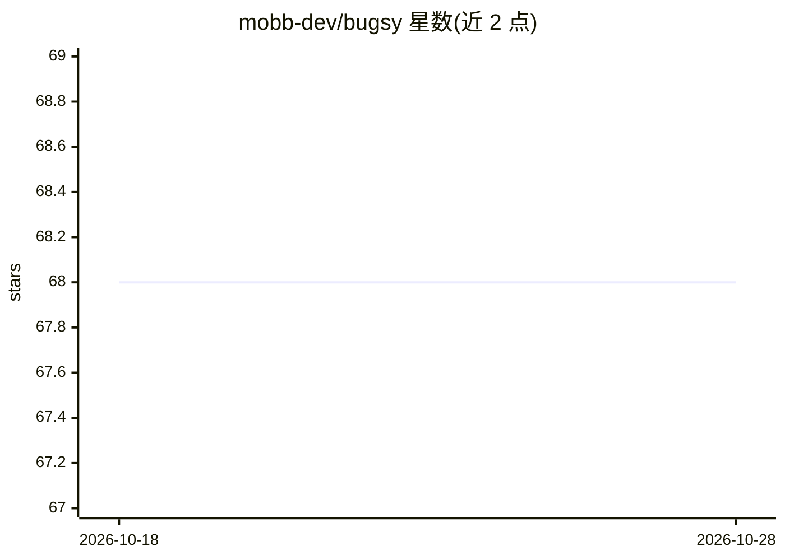

# mobb-dev/bugsy

⭐ 68 · TypeScript · MIT · 推送 2026-08-31 · [GitHub](https://github.com/mobb-dev/bugsy) · [官网](https://mobb.ai) · 组织维护

**面向开发者的自动安全漏洞修复 CLI（Mobb 社区版）**

Mobb 的社区版命令行工具，读取 Checkmarx、CodeQL、Fortify、Snyk 等 SAST 工具的扫描结果，生成代码修复并在 Mobb 平台展示修复报告；另有 Scan 模式直接调用 Checkmarx 或 Snyk CLI 扫描公开 GitHub/GitLab/ADO 仓库。社区版仅分析公开仓库（私有仓库限时）。支持作为 MCP 服务器接入 Claude、Cursor 等 AI 助手，通过 Mobb API key 鉴权，可嵌入 CI/CD 流水线，提供 WebSocket 与 HTTP polling 两种通信模式。

## 筛选速览

| 维度 | 判定 | 备注 |
|---|---|---|
| AI 角色 | `ai-enhanced` | 去掉 AI 部分产品仍成立 |
| 许可风险 | `permissive` | MIT |
| 部署形态 | `library` | 以包/库形式分发 |
| 模型依赖 | — | README 未给出锁定关系 |
| 硬件要求 | — | 无带数字的原话,不猜 |
| 安装摩擦 | `low` | 无编译、无系统依赖或容器化 |
| 成熟度 | — | 结构信号不足 |

## 能力要点

- 读取 Checkmarx/CodeQL/Fortify/Snyk 的 SAST 报告生成代码修复
- 可作为 MCP 服务器供 AI 助手调用 fix_vulnerabilities 工具
- 支持 --ci 模式嵌入 CI/CD 流水线
- 代理/防火墙受限环境可用 --polling 切换 HTTP 轮询

## 适用场景

- 在 CI/CD 中对 SAST 扫描结果自动生成修复补丁
- 让 Claude 等 AI 助手在编码时扫描并修复本地 git 改动的安全漏洞
- 对公开开源仓库运行自动漏洞扫描与修复

## 场景标签

`网络安全` `代码生成` · 领域:编码与开发

## 证据(README 行号)

> L3: Bugsy is a command-line interface (CLI) tool that provides automatic security vulnerability remediation for your cod
> L70: Bugsy can also be used as an MCP server, allowing AI assistants like Claude to automatically scan and fix vulnerabi

## 星数曲线

2026-10-18 68 → 2026-10-28 68（+0）

---
*卡片 v1 · prompt 1.4 · 生成 2026-10-24 · 置信度 mid · 依据 README sha `9ee42e918803` · [字段定义](../../DATASET.md)*
