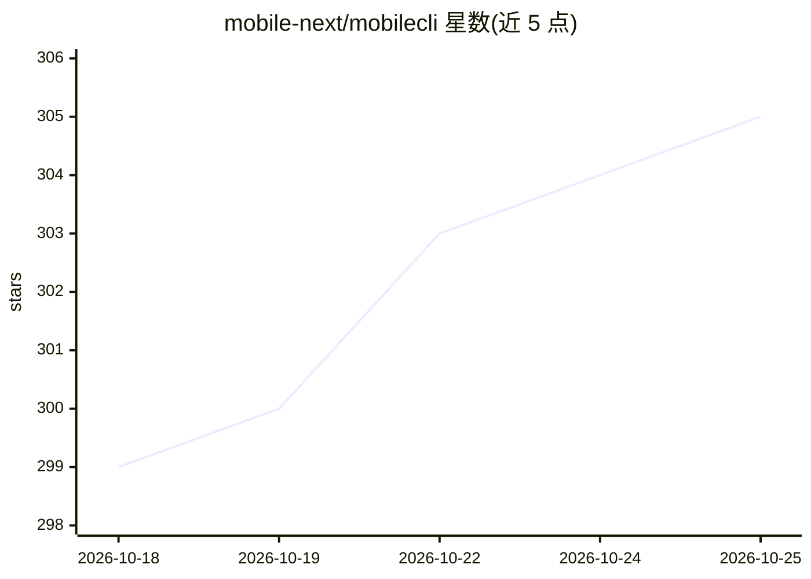

# mobile-next/mobilecli

⭐ 306 · Go · NOASSERTION · 推送 2026-10-19 · [GitHub](https://github.com/mobile-next/mobilecli) · [官网](https://mobilenext.ai) · 组织维护 · 中文 README

**iOS/Android 设备与模拟器统一管理 CLI，支持 AI agent 驱动**

来自 Mobile Next 的跨平台命令行工具，统一管理 iOS 真机/模拟器与 Android 真机/模拟器：设备列举与启动、截图与 mjpeg/h264 视频流、点击/按键控制、App 安装卸载与前台管理、文件系统操作、GPS 位置覆写、崩溃报告、日志流与 Webview 检查。架构上由后台 daemon 维持设备发现与 iOS 隧道，CLI/HTTP/WebSocket 均通过 JSON-RPC 访问同一 daemon。附带 SKILL.md 技能，使 Claude Code 等 agent 可通过自然语言驱动本工具，并通过 npx skills 安装。

## 筛选速览

| 维度 | 判定 | 备注 |
|---|---|---|
| AI 角色 | `ai-ecosystem` | LLM/agent 周边工具 |
| 许可风险 | `none` | NOASSERTION |
| 部署形态 | `library` | 以包/库形式分发 |
| 模型依赖 | — | README 未给出锁定关系 |
| 硬件要求 | — | 无带数字的原话,不猜 |
| 安装摩擦 | `low` | 无编译、无系统依赖或容器化 |
| 成熟度 | — | 结构信号不足 |

## 能力要点

- iOS/Android 真机与模拟器四类平台的统一命令行管理
- 后台 daemon + JSON-RPC 架构，CLI/HTTP/WebSocket 共享设备与隧道
- 截图/视频流、点击按键、文件系统、GPS 覆写、崩溃报告、日志过滤、Webview 检查
- 附带 Claude Code 兼容的 agent 技能（SKILL.md），可由 agent 自然语言驱动

## 适用场景

- 统一管理多台 iOS/Android 测试设备与模拟器
- 让编程 agent 通过对话指令操作真机：截图、点击、装 App
- 通过 HTTP/WebSocket JSON-RPC 接入自动化测试流水线
- 拉取崩溃报告与实时日志定位移动端问题

## 场景标签

`GUI 自动化` · 领域:效率与自动化

## 证据(README 行号)

> L298: This repo includes an agent skill (skills/mobilecli/SKILL.md) that teaches Claude Code (or any SKILL.md-compatible
> L66: ### Agent Setup 🤖

## 星数曲线

2026-10-18 299 → 2026-10-25 305（+6）

---
*卡片 v1 · prompt 1.4 · 生成 2026-10-21 · 置信度 mid · 依据 README sha `7c34262b725b` · [字段定义](../../DATASET.md)*
