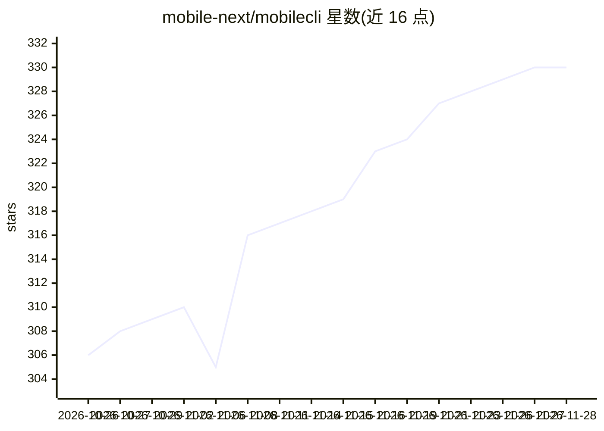

# mobile-next/mobilecli

⭐ 330 · Go · NOASSERTION · 推送 2026-11-25 · [GitHub](https://github.com/mobile-next/mobilecli) · [官网](https://mobilenext.ai) · 组织维护

**给开发者的移动设备/模拟器通用管理命令行工具**

Mobile Next 出品的通用 CLI，覆盖 iOS 实机/模拟器与 Android 实机/模拟器的管理：设备列表与启停、截图与屏幕视频流（mjpeg/H.264）、触控与硬件按键控制、应用安装/卸载/启停、设备文件系统读写、GPS 位置覆盖、崩溃报告获取、实时日志流（支持过滤，可经 HTTP API 访问）、内嵌 Webview 检查（走 Chrome DevTools 协议与 Safari Web Inspector）。后台常驻 daemon 复用设备发现与隧道。内置 SKILL.md 供 Claude Code 等兼容 agent 学习驱动本工具。iOS 触控等能力需设备端 agent。

## 筛选速览

| 维度 | 判定 | 备注 |
|---|---|---|
| AI 角色 | `ai-enhanced` | 去掉 AI 部分产品仍成立 |
| 许可风险 | `none` | NOASSERTION |
| 部署形态 | `library` | 以包/库形式分发 |
| 模型依赖 | — | README 未给出锁定关系 |
| 硬件要求 | — | 无带数字的原话,不猜 |
| 安装摩擦 | `low` | 无编译、无系统依赖或容器化 |
| 成熟度 | — | 结构信号不足 |

## 能力要点

- 跨平台设备管理：iOS 实机/模拟器、Android 实机/模拟器
- 截图、屏幕视频流、触控、按键与 GPS 位置覆盖
- 应用管理、设备文件系统、崩溃报告与过滤日志流
- 内置 SKILL.md 使 Claude Code 等 agent 可自动驱动 CLI

## 适用场景

- 从命令行批量管理 iOS 与 Android 测试设备
- 让编码 agent 自动执行截屏、点击、装包等设备操作
- App 自动化测试中抓取 UI 树、日志与崩溃报告

## 场景标签

`GUI 自动化` · 领域:效率与自动化

## 证据(README 行号)

> L5: A universal command-line tool for managing iOS and Android devices, simulators, emulators and apps from Mobile Next.
> L66: ### Agent Setup 🤖
> L316: This repo includes an agent skill (skills/mobilecli/SKILL.md) that teaches Claude Code (or any SKILL.md-compatible

## 星数曲线

2026-10-26 306 → 2026-11-28 330（+24）

---
*卡片 v1 · prompt 1.4 · 生成 2026-11-25 · 置信度 high · 依据 README sha `a9ba48d4285c` · [字段定义](../../DATASET.md)*
