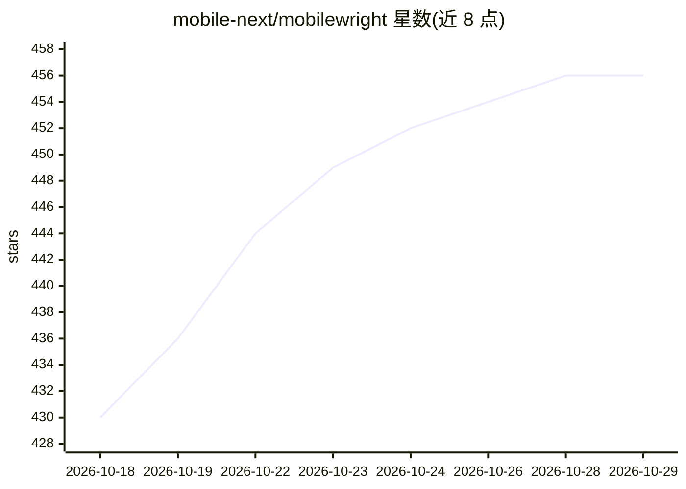

# mobile-next/mobilewright

⭐ 456 · TypeScript · Apache-2.0 · 推送 2026-10-27 · [GitHub](https://github.com/mobile-next/mobilewright) · [官网](https://mobilewright.dev) · 组织维护

**iOS/Android 真机与模拟器自动化测试框架，单一 API 跨平台**

TypeScript 编写的移动应用测试与自动化框架，架构参考 Playwright：提供 screen/getByRole/expect 等 Playwright 风格 API，统一驱动 iOS 与 Android 的真机、模拟器和模拟器实例，底层基于 mobilecli 的 WebSocket JSON-RPC 协议。支持自动等待、可链式定位器、轮询断言、WebView 混合应用桥接为 Playwright 兼容 Page。面向移动开发与测试人员；另声明支持 AI agent 通过读取无障碍树直接操控设备，无需视觉模型，可配合 Claude、Cursor 等 agent 使用。需 Node.js >= 22.12 与已启动的设备环境。

## 筛选速览

| 维度 | 判定 | 备注 |
|---|---|---|
| AI 角色 | `ai-enhanced` | 去掉 AI 部分产品仍成立 |
| 许可风险 | `permissive` | Apache-2.0 |
| 部署形态 | `library` | 以包/库形式分发 |
| 模型依赖 | — | README 未给出锁定关系 |
| 硬件要求 | — | 无带数字的原话,不猜 |
| 安装摩擦 | `low` | 无编译、无系统依赖或容器化 |
| 成熟度 | — | 结构信号不足 |

## 能力要点

- Playwright 风格 API（getByRole/expect/自动等待/可链式定位器）
- iOS/Android 真机、模拟器统一接口，零配置自动发现设备
- WebView 混合应用桥接为 Playwright 兼容 Page
- 暴露无障碍树供 AI agent 直接读取与操作，无需视觉模型

## 适用场景

- 用一套代码同时测试 iOS 和 Android 应用
- 在真机与模拟器上运行端到端自动化测试
- 让 AI agent 通过无障碍树直接操控手机执行任务
- 远程连接设备机房进行测试（mobilecli/Mobile Next Cloud）

## 场景标签

`GUI 自动化` · 领域:效率与自动化

## 证据(README 行号)

> L7: Framework for mobile device automation, inspired by Playwright's architecture and developer experience.
> L62: Mobilewright exposes the device's accessibility tree — deterministic, token-efficient, no vision model needed. Use 

## 星数曲线

2026-10-18 430 → 2026-10-29 456（+26）

---
*卡片 v1 · prompt 1.4 · 生成 2026-10-21 · 置信度 high · 依据 README sha `87edd9b3893d` · [字段定义](../../DATASET.md)*
