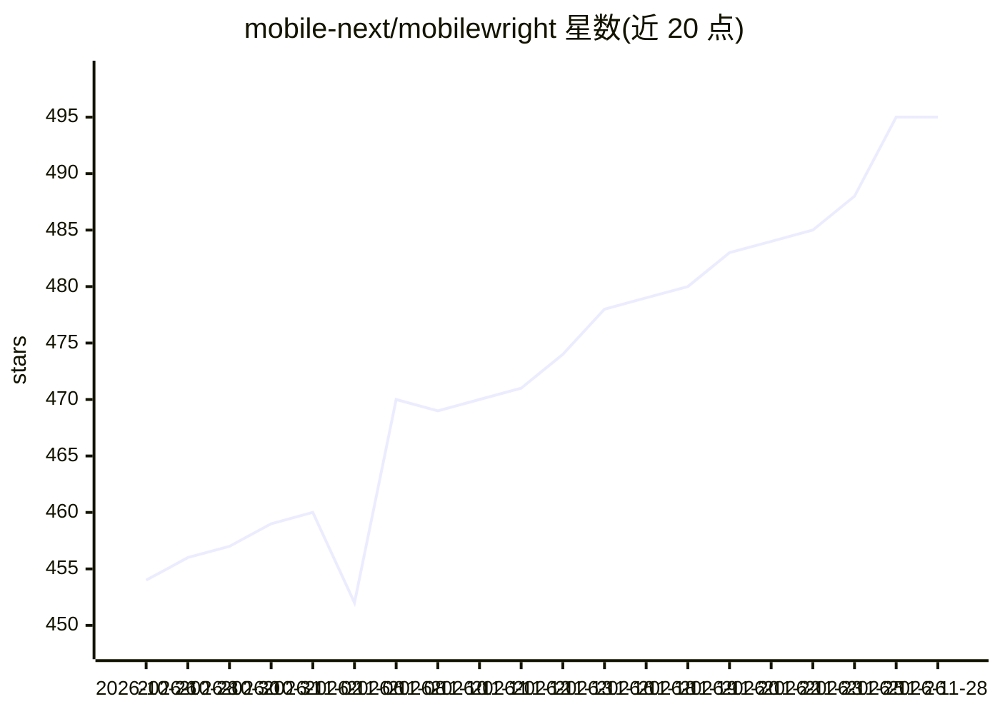

# mobile-next/mobilewright

⭐ 495 · TypeScript · Apache-2.0 · 推送 2026-11-24 · [GitHub](https://github.com/mobile-next/mobilewright) · [官网](https://mobilewright.dev) · 组织维护

**移动端自动化测试框架：一套 API 驱动 iOS/Android 真机与模拟器**

面向移动应用自动化与端到端测试的框架，提供四种使用路径：扩展 Playwright Test 的测试包、供终端与编码代理调用的 CLI、面向 AI 代理的 MCP 服务器、以及可在脚本中直接调用的 JavaScript/TypeScript 库。支持 iOS 与 Android 的模拟器、仿真器与真机，提供 Playwright 风格的定位器、自动等待、断言重试、截图、WebView 控制与 HTML 报告。前置条件包括 Node.js 22.12+，iOS 需 macOS/Xcode，Android 需 JDK 与 Android SDK；真机 iOS 需签名配置描述文件。

## 筛选速览

| 维度 | 判定 | 备注 |
|---|---|---|
| AI 角色 | `ai-enhanced` | 去掉 AI 部分产品仍成立 |
| 许可风险 | `permissive` | Apache-2.0 |
| 部署形态 | `library` | 以包/库形式分发 |
| 模型依赖 | — | README 未给出锁定关系 |
| 硬件要求 | — | 无带数字的原话,不猜 |
| 安装摩擦 | `low` | 无编译、无系统依赖或容器化 |
| 成熟度 | — | 结构信号不足 |

## 能力要点

- 四种入口：Test 测试包、CLI、MCP 服务器、JS/TS 库
- Playwright 风格 API：链式定位器、自动等待、重试断言
- MCP 服务器向 AI 代理暴露设备发现、安装、手势、截图等工具
- 支持混合应用 WebView 的 Playwright 兼容 Page/Locator API

## 适用场景

- 对 iOS/Android 应用编写可重复运行的端到端测试
- 让编码代理或 MCP 客户端探索设备流程并生成测试
- 在真机、模拟器或云设备上批量自动化操作应用

## 场景标签

`GUI 自动化` · 领域:效率与自动化

## 证据(README 行号)

> L7: **Mobilewright is a framework for mobile automation and testing.** Control iOS and Android devices, simulators, and 
> L178: Mobilewright MCP gives AI agents device control through the Model Context Protocol. The `@mobilewright/mcp` packag
> L246: - **iOS and Android** — automate native and hybrid apps on simulators, emulators, and real devices.

## 星数曲线

2026-10-26 454 → 2026-11-28 495（+41）

---
*卡片 v1 · prompt 1.4 · 生成 2026-11-26 · 置信度 high · 依据 README sha `42af2343c01b` · [字段定义](../../DATASET.md)*
