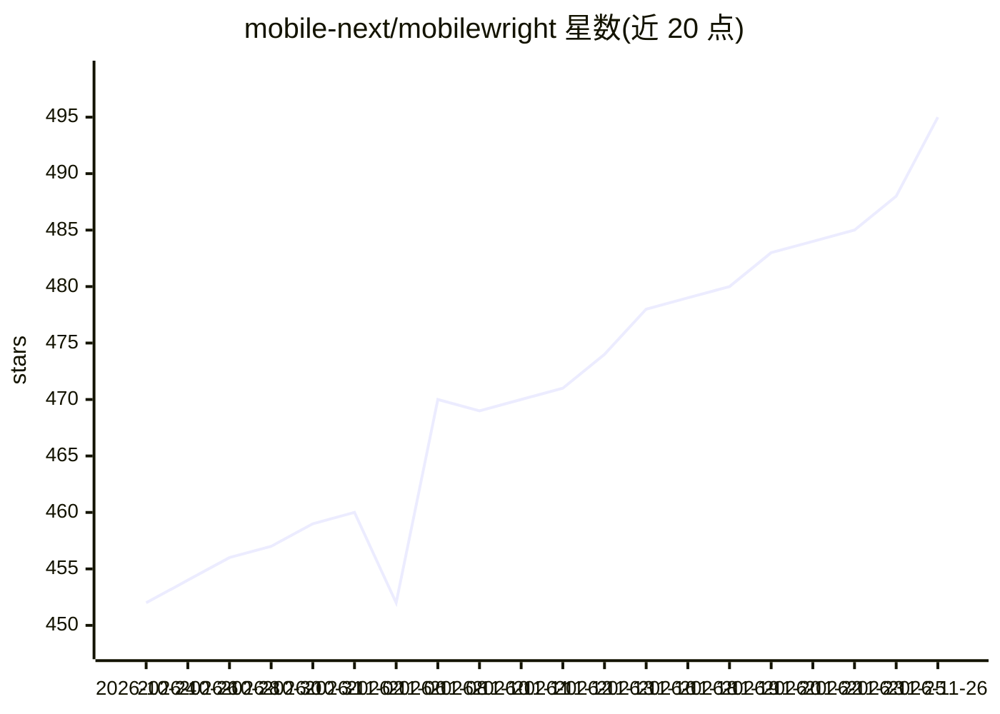

# mobile-next/mobilewright

⭐ 495 · TypeScript · Apache-2.0 · 推送 2026-11-24 · [GitHub](https://github.com/mobile-next/mobilewright) · [官网](https://mobilewright.dev) · 组织维护

**移动 App 自动化测试框架：iOS/Android 统一 Playwright 风格 API**

基于 mobilecli 构建的移动设备自动化与端到端测试框架，通过统一 API 驱动 iOS/Android 真机、模拟器与仿真器。核心机制包括自动发现已启动设备、每步操作前等待元素可见/可用/位置稳定的 auto-waiting、可链式定位器与轮询断言；以无障碍树而非截图作为元素来源，面向 AI agent 场景暴露确定性语义接口。npm 安装，需 Node.js ≥22.12 及 Xcode/Android SDK/ADB 等环境，提供 mobilewright doctor 自检。

## 筛选速览

| 维度 | 判定 | 备注 |
|---|---|---|
| AI 角色 | `ai-enhanced` | 去掉 AI 部分产品仍成立 |
| 许可风险 | `permissive` | Apache-2.0 |
| 部署形态 | `library` | 以包/库形式分发 |
| 模型依赖 | — | README 未给出锁定关系 |
| 硬件要求 | — | 无带数字的原话,不猜 |
| 安装摩擦 | `low` | 无编译、无系统依赖或容器化 |
| 成熟度 | — | 结构信号不足 |

## 能力要点

- iOS/Android 真机、模拟器、仿真器的统一 API
- 以无障碍树驱动的 AI agent 支持，无需视觉模型
- Playwright 风格定位器与 auto-waiting 断言
- WebView 混合应用的 Playwright 兼容 Page 桥接

## 适用场景

- 为 iOS/Android App 编写端到端 UI 测试
- 让 Claude/Cursor 等编码 agent 直接操控真机
- 同一套测试脚本覆盖双平台设备实验室

## 场景标签

`GUI 自动化` · 领域:效率与自动化

## 证据(README 行号)

> L7: Framework for mobile device automation, inspired by Playwright's architecture and developer experience.
> L62: Mobilewright exposes the device's accessibility tree — deterministic, token-efficient, no vision model needed. Use 

## 星数曲线

2026-10-24 452 → 2026-11-26 495（+43）

---
*卡片 v1 · prompt 1.4 · 生成 2026-11-25 · 置信度 high · 依据 README sha `6ebf47db23cc` · [字段定义](../../DATASET.md)*
