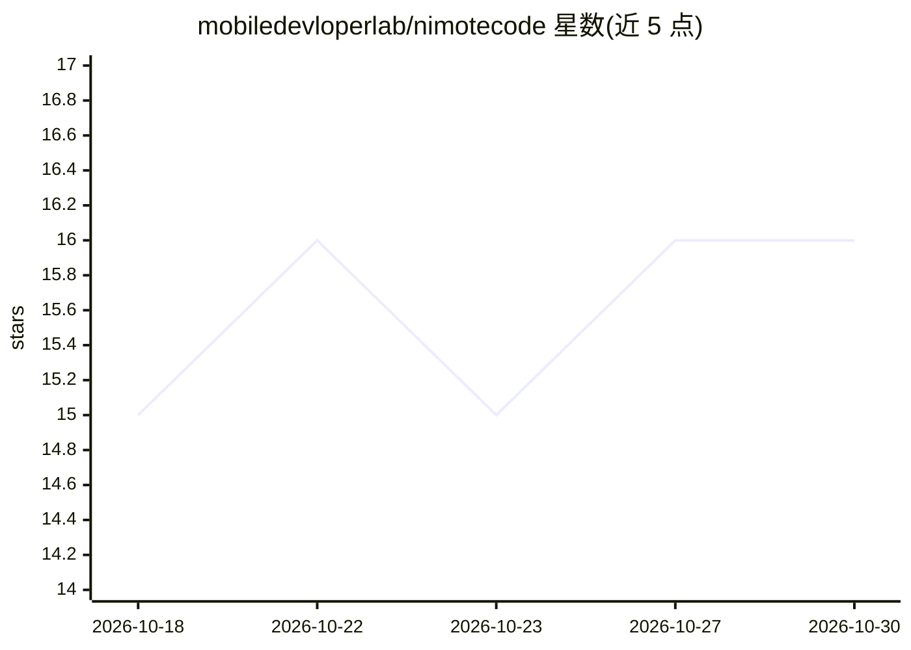

# mobiledevloperlab/nimotecode

⭐ 16 · Shell · 推送 2026-10-29 · [GitHub](https://github.com/mobiledevloperlab/nimotecode) · [官网](https://nimotecode.com/) · 组织维护 · 中文 README

**Android/iOS 移动 IDE：编辑器、SSH、Git 与 AI 编码代理**

面向手机与平板的移动开发工作区：本地或经 SSH 编辑远程项目、终端、Git 状态/diff/分支查看与 Early Access 的提交推送、LSP 诊断与调试，以及在支持的 Android 设备上通过 PRoot 运行免 root Ubuntu。AI 功能为可选项：AI Chat（自带 API key）、内置 Agent 与 MCP 工具服务器、经 SSH 运行 Claude Code/Codex CLI。商业闭源应用，本仓库仅存放文档与教程；高级功能通过 Early Access 提供，AI 模型访问与 token 不包含在内。

## 筛选速览

| 维度 | 判定 | 备注 |
|---|---|---|
| AI 角色 | `ai-enhanced` | 去掉 AI 部分产品仍成立 |
| 许可风险 | `none` | — |
| 部署形态 | `None` |  |
| 模型依赖 | — | README 未给出锁定关系 |
| 硬件要求 | — | 无带数字的原话,不猜 |
| 安装摩擦 | `low` | 无编译、无系统依赖或容器化 |
| 成熟度 | `idea` | |

## 能力要点

- 本地编辑 + SSH 远程开发 + 免 root Ubuntu（PRoot，Android 8+ ARM64/x86_64）
- 内置 AI Agent、MCP 工具服务器（Early Access，每次工具调用需批准）
- AI Chat 连接用户自有 AI provider 与 API key，模型访问不随应用提供
- 通过 SSH 终端运行 Claude Code / Codex CLI（需自行安装，不随附）

## 适用场景

- 在手机/平板上编辑本地或 SSH 远程项目并查看 Git diff
- 在外出场景让内置 Agent 完成有边界的代码修改任务
- 在 Android 设备上运行 Linux 脚本与命令行工具

## 场景标签

`编码 Agent` · 领域:编码与开发

## 证据(README 行号)

> L21:  Free to start. AI setup is optional. Commercial, closed-source app · Official documentation and community resource
> L101: - **Work with AI:** ask about code, delegate a bounded task to the built-in Agent, or use compatible agents on you
> L125: **Free to start, with advanced workflows through Early Access:** Free includes local, SSH and Android Local Linux 

## 星数曲线

2026-10-18 15 → 2026-10-30 16（+1）

---
*卡片 v1 · prompt 1.4 · 生成 2026-10-30 · 置信度 high · 依据 README sha `eb170db5af8d` · [字段定义](../../DATASET.md)*
