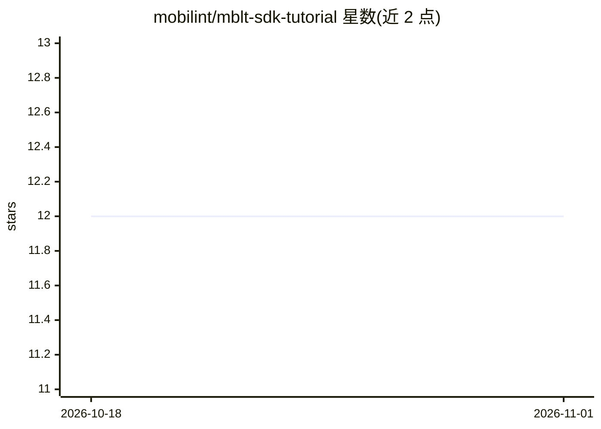

# mobilint/mblt-sdk-tutorial

⭐ 12 · Python · BSD-3-Clause · 推送 2026-10-30 · [GitHub](https://github.com/mobilint/mblt-sdk-tutorial) · [官网](https://www.mobilint.com/) · 组织维护

**Mobilint NPU SDK（qbcompiler/qbruntime）官方入门教程仓库**

Mobilint 公司为其 SDK qb 提供的示例与讲解仓库，覆盖两大组件：qbcompiler 将主流深度学习框架模型量化、优化并编译为 MXQ 格式；qbruntime 使编译后的 MXQ 模型可在 Mobilint NPU（ARIES/REGULUS）上执行并集成到应用中。教程分 compilation 与 runtime（Python 与 C++ 交叉编译）目录。使用前提是拥有 Mobilint NPU 硬件，SDK 本体需在 Mobilint Download Center 注册后下载，本仓库不含 SDK 安装命令。

## 筛选速览

| 维度 | 判定 | 备注 |
|---|---|---|
| AI 角色 | `ai-ecosystem` | LLM/agent 周边工具 |
| 许可风险 | `permissive` | BSD-3-Clause |
| 部署形态 | `None` |  |
| 模型依赖 | — | README 未给出锁定关系 |
| 硬件要求 | — | 无带数字的原话,不猜 |
| 安装摩擦 | `low` | 无编译、无系统依赖或容器化 |
| 成熟度 | — | 结构信号不足 |

## 能力要点

- qbcompiler 将深度学习框架模型量化编译为 MXQ 格式
- qbruntime 支持 Python 与 C++ 交叉编译两种运行时教程
- 支持 ARIES 与 REGULUS 两款 NPU 设备

## 适用场景

- 在 Mobilint NPU 上部署自己的深度学习模型
- 学习 MXQ 模型的编译与量化流程
- 将编译后模型集成到 Python 或 C++ 应用

## 场景标签

`教程课程` · 领域:学习与行业

## 证据(README 行号)

> L9: This repository provides examples and explanations to help users easily get started with the Mobilint SDK qb, which 
> L37: The Mobilint qbcompiler converts models from popular deep learning frameworks into the Mobilint eXeQutable (MXQ) fo
> L40: The Mobilint qbruntime enables execution of the compiled MXQ models on the NPU.

## 星数曲线

2026-10-18 12 → 2026-11-01 12（+0）

---
*卡片 v1 · prompt 1.4 · 生成 2026-11-01 · 置信度 high · 依据 README sha `773921358d24` · [字段定义](../../DATASET.md)*
