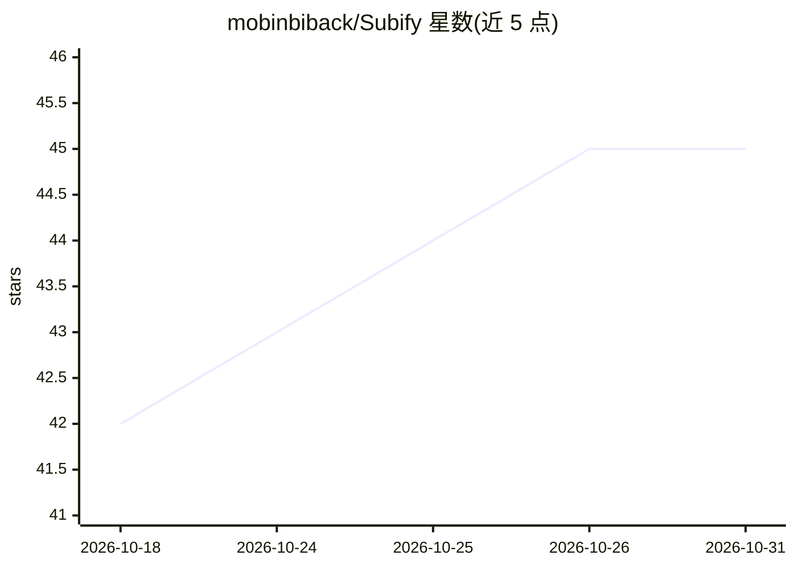

# mobinbiback/Subify

⭐ 45 · JavaScript · MIT · 推送 2026-10-13 · [GitHub](https://github.com/mobinbiback/Subify) · [官网](http://sub-ify.site/) · 个人维护 · 中文 README

**浏览器扩展：网页/视频的 AI 翻译、双语字幕、AI 配音与语言学习**

面向 Chromium 与 Firefox 的免费开源浏览器扩展，为多语言网页与视频内容提供实时翻译、双语字幕、AI 配音（音量/原声抑制/语速/声音选择）、整页翻译、词典与词汇保存复习（本地存储），字幕可导出 SRT/VTT/TXT。采用 Provider 架构，用户自带 API Key，当前支持 Google Gemini、OpenRouter、OpenAI。在 YouTube、Udemy、edX、Khan Academy、LinkedIn Learning、TED 上测试过字幕与配音。设置与词汇数据以 Local-first 方式存于浏览器。

## 筛选速览

| 维度 | 判定 | 备注 |
|---|---|---|
| AI 角色 | `ai-native` | 本体是模型或模型工具 |
| 许可风险 | `permissive` | MIT |
| 部署形态 | `None` |  |
| 模型依赖 | locked-api |  |
| 硬件要求 | — | 无带数字的原话,不猜 |
| 安装摩擦 | `low` | 无编译、无系统依赖或容器化 |
| 成熟度 | — | 结构信号不足 |

## 能力要点

- 实时翻译、预翻译与双语字幕显示
- AI 配音（音量、原声抑制、语速、声音可选）与整页翻译
- 词典、词汇保存与本地复习（Learn）系统
- Provider 架构，用户自配 API Key，支持 Gemini/OpenRouter/OpenAI

## 适用场景

- 看外语视频时显示双语字幕或 AI 配音
- 边看边查生词并保存复习，辅助语言学习
- 将网页全文翻译或把字幕导出为 SRT/VTT

## 场景标签

`语音合成` · 领域:内容生成

## 证据(README 行号)

> L28: با Subify می‌توانی محتوای ویدیویی و متنی را ترجمه کنی، زیرنویس دوزبانه داشته باشی، از قابلیت دوبله صوتی با هوش مصنو
> L105: - Google Gemini

## 星数曲线

2026-10-18 42 → 2026-10-31 45（+3）

---
*卡片 v1 · prompt 1.4 · 生成 2026-10-25 · 置信度 high · 依据 README sha `7fbf6ae7da1f` · [字段定义](../../DATASET.md)*
