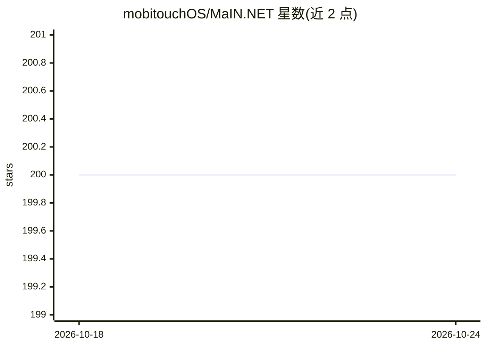

# mobitouchOS/MaIN.NET

⭐ 200 · C# · MIT · 推送 2026-10-19 · [GitHub](https://github.com/mobitouchOS/MaIN.NET) · [官网](https://usemain.net) · 组织维护

**.NET 库：将 LLM、RAG 与 Agent 集成进 AI 工作流**

MaIN.NET（Modular Artificial Intelligence Network）是发布在 NuGet 的 .NET 包，用于把大语言模型接入 AI 工作流，覆盖聊天机器人、流程自动化与 Agent 构建等场景，定位为模块化连接多种 AI 方法的统一框架。本地模型部分由 LLamaSharp 项目驱动（作者声明其启发于该项目）。安装通过 dotnet add package MaIN.NET 或 NuGet CLI 完成；交互式文档站点 www.usemain.net 提供多个专用 AI agent（问答、代码生成、多 agent 架构设计、用法审计等）供探索框架。

## 筛选速览

| 维度 | 判定 | 备注 |
|---|---|---|
| AI 角色 | `ai-ecosystem` | LLM/agent 周边工具 |
| 许可风险 | `permissive` | MIT |
| 部署形态 | `None` |  |
| 模型依赖 | — | README 未给出锁定关系 |
| 硬件要求 | — | 无带数字的原话,不猜 |
| 安装摩擦 | `medium` | 含编译或系统依赖之一 |
| 成熟度 | — | 结构信号不足 |

## 能力要点

- NuGet 包形式提供，dotnet add package MaIN.NET 即可安装
- 本地模型由 LLamaSharp 项目驱动
- 文档站点提供 Code/Design/Review/Forge 等专用 AI agent 探索框架
- 面向低代码理念，面向开发者与非开发者

## 适用场景

- 在 .NET 应用中构建聊天机器人与 LLM 工作流
- 用 C# 搭建多 agent 系统
- 通过文档站点的 AI agent 生成示例项目与审计用法

## 场景标签

`RAG` `多智能体` `Agent 框架` · 领域:Agent 开发

## 证据(README 行号)

> L7: **MaIN** (Modular Artificial Intelligence Network) is a versatile .NET package designed to streamline the integratio
> L9: The work on the package started with the learning and inspiration gained by using the LLamaSharp project and current

## 星数曲线

2026-10-18 200 → 2026-10-24 200（+0）

---
*卡片 v1 · prompt 1.4 · 生成 2026-10-22 · 置信度 mid · 依据 README sha `bcdd12b28d29` · [字段定义](../../DATASET.md)*
