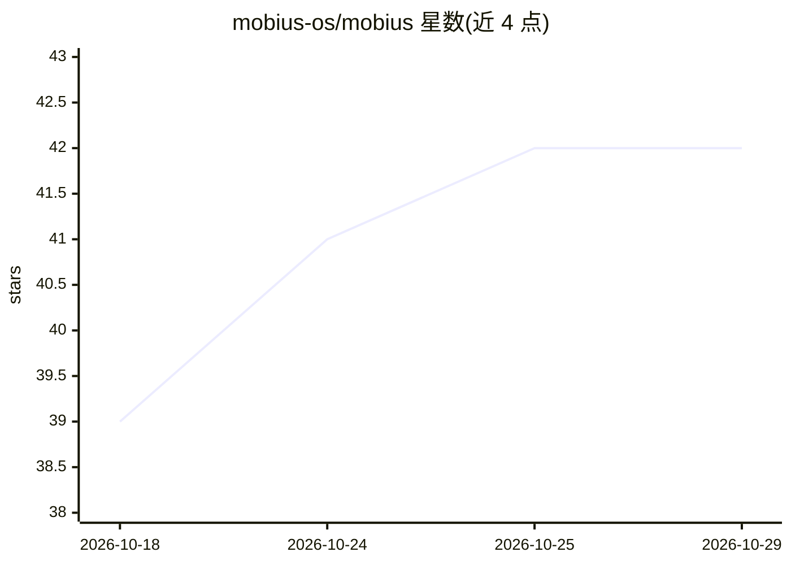

# mobius-os/mobius

⭐ 42 · Python · MIT · 推送 2026-10-28 · [GitHub](https://github.com/mobius-os/mobius) · [官网](https://www.mobius.you) · 组织维护

**自托管个人 AI agent 工作区：对话式 agent 代办任务并构建应用**

Möbius 是一个 MIT 许可的自托管平台，作为 AI agent 的运行环境与界面：在网页、手机或自有服务器上承载 agent、应用、记忆、技能、文件与源码。用户以对话方式下达目标、定时任务，agent 可调用 Claude Code 或 Codex 作为编码代理构建 mini-app 并安装到手机；具备记忆图谱、夜间反思、技能积累、App Store 应用分发与团队共享 agent 池等机制。自托管需 Docker、域名与 Claude Code 或 ChatGPT 账号，通过 git clone 与 docker compose 部署，Caddy 配置 HTTPS；另有 mobius.you 托管部署选项。

## 筛选速览

| 维度 | 判定 | 备注 |
|---|---|---|
| AI 角色 | `ai-native` | 本体是模型或模型工具 |
| 许可风险 | `permissive` | MIT |
| 部署形态 | `self-host` | docker 或自建部署 |
| 模型依赖 | locked-api |  |
| 硬件要求 | — | 无带数字的原话,不猜 |
| 安装摩擦 | `low` | 无编译、无系统依赖或容器化 |
| 成熟度 | — | 结构信号不足 |

## 能力要点

- 对话中构建 mini-app，可安装为手机独立应用并发布到 App Store
- 目标/定时任务/子代理工作流，委托 Claude Code 与 Codex 运行
- 记忆图谱、夜间反思与可安装技能，使用越久越个性化
- API key 经安全输入且模型不可见，支持本地语音模型

## 适用场景

- 让 agent 按目标持续代办工作并只把关键决策交给我
- 用自然语言让 agent 为我构建并迭代小应用
- 在自己服务器上运行并掌控个人 AI agent 的全部数据

## 场景标签

`编码 Agent` `AI 助手` · 领域:编码与开发

## 证据(README 行号)

> L5:  Your portal to the world of AI agents. A chatbot answers; an agent does the work. Möbius is the home for yours: on 
> L20: Möbius is the harness and the interface for working with AI agents: a self-hosted workspace where apps, agents, mem
> L63: Say what you need in your own words: “Build a News app for the topics I follow.” “Build a simple habits app.” The a

## 星数曲线

2026-10-18 39 → 2026-10-29 42（+3）

---
*卡片 v1 · prompt 1.4 · 生成 2026-10-25 · 置信度 high · 依据 README sha `88b6da8861b3` · [字段定义](../../DATASET.md)*
