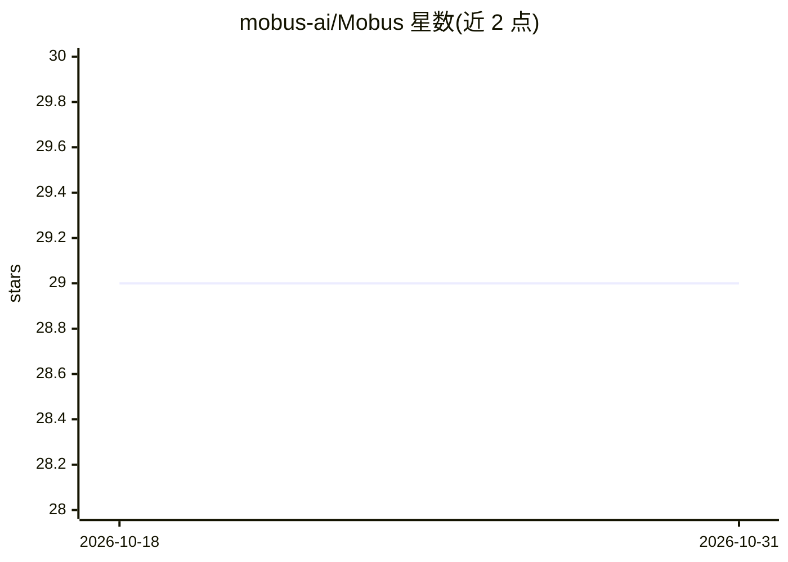

# mobus-ai/Mobus

⭐ 29 · TypeScript · MIT · 推送 2026-06-08 · [GitHub](https://github.com/mobus-ai/Mobus) · [官网](http://mobus.ai/) · 个人维护

**跨 20 平台数据集搜索与预览的 MCP 连接器**

面向 AI 助手（Claude、Cursor 等）的 MCP 连接器：通过单一对话检索、预览、评估 20 个数据平台的数据集，提供 15 个工具，涵盖搜索、并行分发请求、元数据获取、行级预览、2-5 数据集对比、质量评估、许可证核查、引文生成（APA/BibTeX/Chicago）、ECharts 可视化与引用谱系追踪。托管版无需安装即可接入 Claude；也可通过 git clone 与 npm 自托管。缺失 API key 的平台自动跳过；Papers with Code API 已关停，谱系/引用图相关工具当前报错。

## 筛选速览

| 维度 | 判定 | 备注 |
|---|---|---|
| AI 角色 | `ai-ecosystem` | LLM/agent 周边工具 |
| 许可风险 | `permissive` | MIT |
| 部署形态 | `library` | 以包/库形式分发 |
| 模型依赖 | — | README 未给出锁定关系 |
| 硬件要求 | — | 无带数字的原话,不猜 |
| 安装摩擦 | `low` | 无编译、无系统依赖或容器化 |
| 成熟度 | — | 结构信号不足 |

## 能力要点

- 跨 20 平台并行搜索数据集，缺失 key 的平台自动跳过
- 质量评估、许可证核查与模式兼容性检查
- 引文生成（APA/BibTeX/Chicago）与数据集谱系追踪
- 托管版零安装接入 Claude，也可 npm 自托管

## 适用场景

- 在对话中一站式查找多平台数据集并预览前 N 行
- 核查数据集许可证是否允许商用
- 为使用的数据集生成规范引文

## 场景标签

`科研工具` · 领域:学习与行业

## 证据(README 行号)

> L3: **Dataset search for AI assistants**
> L8: MCP
> L11: ## Connect to Claude

## 星数曲线

2026-10-18 29 → 2026-10-31 29（+0）

---
*卡片 v1 · prompt 1.4 · 生成 2026-10-26 · 置信度 high · 依据 README sha `d06e85381057` · [字段定义](../../DATASET.md)*
