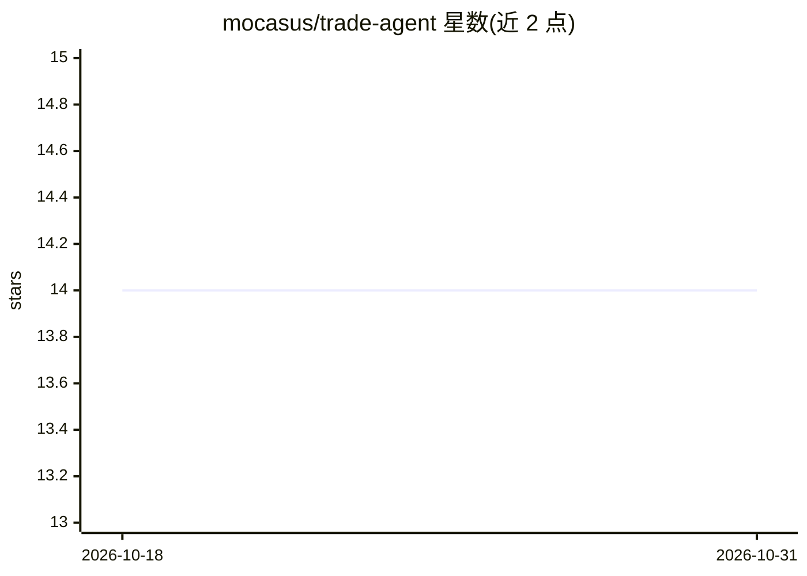

# mocasus/trade-agent

⭐ 14 · Python · MIT · 推送 2026-07-04 · [GitHub](https://github.com/mocasus/trade-agent) · [官网](https://github.com/mocasus/trade-agent#quick-start) · 个人维护

**模块化 AI 加密货币交易 agent：LLM 分析行情后决策执行**

基于插件系统的模块化 AI 交易机器人：LLM 通过 OpenAI 兼容 API 分析市场数据、新闻情绪与技术指标（RSI/MACD/EMA/布林带/ATR），输出结构化交易决策并执行。提供 7 个可替换插件槽位（数据源/策略/交易所/通知/情绪/风险/指标），支持 ccxt、Bybit 期货、paper 模拟盘等。安全机制包括默认且首 24 小时强制的 paper 模式、Telegram 急停、每日亏损硬性限制与决策审计日志。附带回测引擎（Sharpe/回撤/胜率）、Web 仪表盘、Docker 部署与 39 项测试。

## 筛选速览

| 维度 | 判定 | 备注 |
|---|---|---|
| AI 角色 | `ai-native` | 本体是模型或模型工具 |
| 许可风险 | `permissive` | MIT |
| 部署形态 | `self-host` | docker 或自建部署 |
| 模型依赖 | — | README 未给出锁定关系 |
| 硬件要求 | — | 无带数字的原话,不猜 |
| 安装摩擦 | `low` | 无编译、无系统依赖或容器化 |
| 成熟度 | — | 结构信号不足 |

## 能力要点

- 7 个可替换插件槽位、21 个内置插件
- LLM 策略：OpenAI 兼容 API 分析市场+新闻+指标输出结构化决策
- 默认 paper 模式、Telegram 急停、每日亏损限制等安全机制
- 回测引擎输出总收益/胜率/Sharpe/最大回撤

## 适用场景

- 用 LLM 或纯配置规则在加密货币交易所自动交易
- 先在 paper 模式回测和模拟验证策略再考虑实盘
- 通过 Telegram/Discord 接收交易通知并远程急停

## 场景标签

`金融量化` · 领域:学习与行业

## 证据(README 行号)

> L6:  LLM analyzes market + news + indicators → decision → execution.
> L71: - 🤖 **LLM strategy** — OpenAI-compatible API analyzes market context → structured decision

## 星数曲线

2026-10-18 14 → 2026-10-31 14（+0）

---
*卡片 v1 · prompt 1.4 · 生成 2026-10-31 · 置信度 high · 依据 README sha `7525f6903b15` · [字段定义](../../DATASET.md)*
