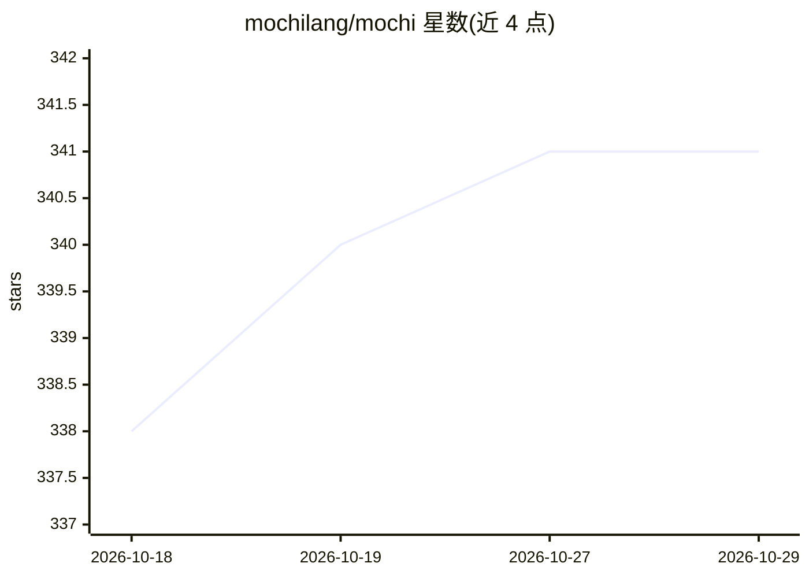

# mochilang/mochi

⭐ 341 · Scheme · MIT · 推送 2026-06-01 · [GitHub](https://github.com/mochilang/mochi) · [官网](https://mochi-lang.dev) · 组织维护

**面向 agent 与 AI 的静态类型嵌入式编程语言**

Mochi 是一个小型静态类型编程语言，以零依赖单二进制形式提供，内含字节码 VM 与 CLI。语言特性包括函数式语法、SQL 风格数据集查询与 join、流与 agent 构造、union 类型、FFI（Go/Python/TypeScript）、内置 test/expect 测试块，以及直接调用 LLM 的 generate 块和把函数暴露为 LLM 工具的能力。可运行 `mochi serve` 作为 MCP 服务器向 Claude、VS Code Agent Mode 等提供 mochi_eval/mochi_cheatsheet 工具。README 列出大量尚未在所有后端实现的功能限制，语言仍在活跃开发中。安装途径为预编译二进制、Docker 镜像或源码构建。

## 筛选速览

| 维度 | 判定 | 备注 |
|---|---|---|
| AI 角色 | `ai-ecosystem` | LLM/agent 周边工具 |
| 许可风险 | `permissive` | MIT |
| 部署形态 | `self-host` | docker 或自建部署 |
| 模型依赖 | — | README 未给出锁定关系 |
| 硬件要求 | — | 无带数字的原话,不猜 |
| 安装摩擦 | `low` | 无编译、无系统依赖或容器化 |
| 成熟度 | — | 结构信号不足 |

## 能力要点

- generate 块直接调用 LLM，可将 Mochi 函数暴露为 LLM 工具
- `mochi serve` 以 MCP 服务器形式提供 mochi_eval / mochi_cheatsheet 工具
- 零依赖单二进制，内置字节码 VM 与常量折叠、活跃度死代码消除优化
- 流（stream）与 agent 构造：事件处理、持久状态与 intent 函数

## 适用场景

- 用一种语言编写调用 LLM 的 agent 与数据处理脚本
- 通过 MCP 在 Claude Desktop 或 VS Code Agent Mode 中执行 Mochi 程序
- 用 SQL 风格语法做数据集查询与 join 处理
- 以 Docker 方式运行嵌入式脚本运行时

## 场景标签

 · 领域:编程语言/开发工具

## 证据(README 行号)

> L301: Invoke large language models directly from Mochi using the `generate` block.
> L311: You can also expose Mochi functions as tools for the LLM to call:
> L404: ## MCP Tools

## 星数曲线

2026-10-18 338 → 2026-10-29 341（+3）

---
*卡片 v1 · prompt 1.4 · 生成 2026-10-21 · 置信度 mid · 依据 README sha `22d3a7695b1c` · [字段定义](../../DATASET.md)*
