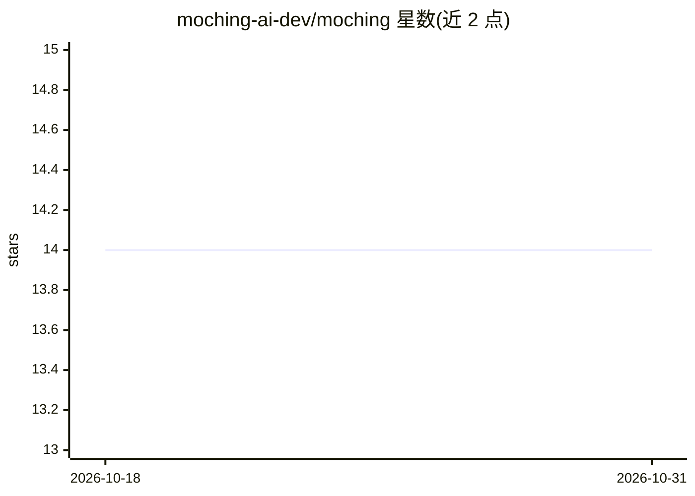

# moching-ai-dev/moching

⭐ 14 · NOASSERTION · 推送 2026-10-17 · [GitHub](https://github.com/moching-ai-dev/moching) · [官网](https://mochingcode.com) · 组织维护 · 中文 README

**控制整台电脑的桌面 AI 操作员：290+ 工具自动执行任务**

面向桌面用户的数字操作员（digital operator）：通过屏幕感知（实时截屏、UI 树、AI 视觉分析）、HID 控制（鼠标/键盘/剪贴板）与浏览器自动化（Playwright 57 工具），以“感知→决策→执行→验证”循环在真实桌面完成任务。内置 290+ 原生工具覆盖 12 个域，含 Office 文档套件、媒体处理、AI 生图/TTS/视频生成、L1/L3 记忆与知识库、技能商店。Rust 核心 + Python，提供 Windows x64 与 macOS Apple Silicon 安装包（384/843 MB），自带模型 key（OpenAI/Claude/Gemini 或 OpenAI 兼容端点）；注册免费 14 天，含积分充值与推荐机制；源码为专有许可。

## 筛选速览

| 维度 | 判定 | 备注 |
|---|---|---|
| AI 角色 | `ai-native` | 本体是模型或模型工具 |
| 许可风险 | `none` | NOASSERTION |
| 部署形态 | `desktop` | 安装包/桌面程序 |
| 模型依赖 | — | README 未给出锁定关系 |
| 硬件要求 | — | 无带数字的原话,不猜 |
| 安装摩擦 | `low` | 无编译、无系统依赖或容器化 |
| 成熟度 | — | 结构信号不足 |

## 能力要点

- 屏幕感知 + HID 控制的桌面自动化执行循环
- 290+ 原生工具 × 12 域（系统控制/浏览器/Office/媒体/AI 生成等）
- L1 短期 + L3 持久知识库，PDF/Word/Excel 摄取自动向量化
- 技能商店提供 30+ 官方技能

## 适用场景

- 让 AI 直接操作我的电脑完成办公与文档任务
- 自动执行浏览器操作与跨应用流程
- 用自然语言驱动本机的媒体处理与文件管理

## 场景标签

`GUI 自动化` `浏览器自动化` `AI 助手` · 领域:效率与自动化

## 证据(README 行号)

> L37: Most AI tools live inside a browser tab. **Moching lives on your desktop** — it sees your screen, moves your mouse,
> L88: 👀 See Screen  →  🧠 Understand  →  🖱️ Take Action  →  ✅ Verify Result

## 星数曲线

2026-10-18 14 → 2026-10-31 14（+0）

---
*卡片 v1 · prompt 1.4 · 生成 2026-10-31 · 置信度 high · 依据 README sha `5d28045da1b7` · [字段定义](../../DATASET.md)*
