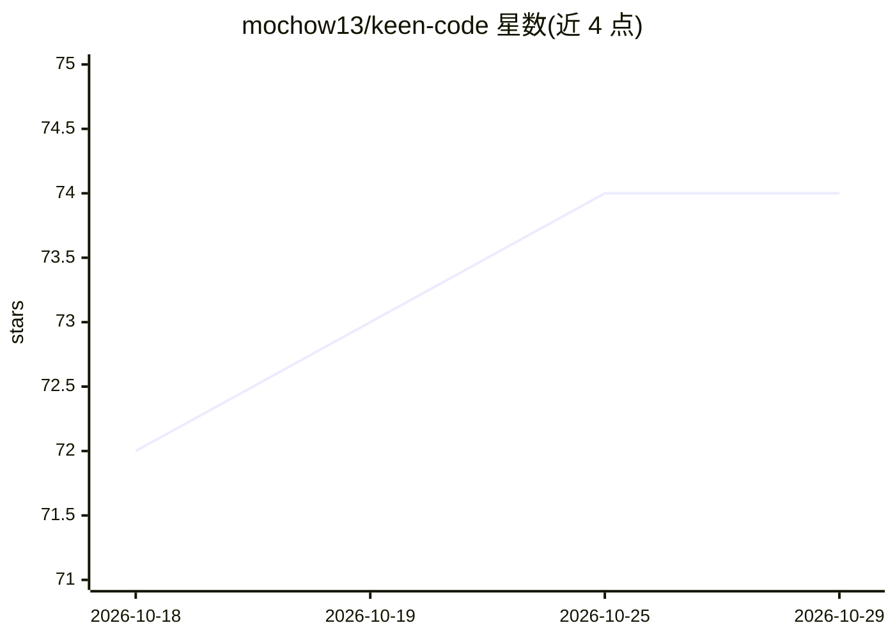

# mochow13/keen-code

⭐ 74 · Go · MIT · 推送 2026-10-27 · [GitHub](https://github.com/mochow13/keen-code) · [官网](https://mochow13.github.io/keen-code/) · 个人维护 · 中文 README

**终端 AI 编码 agent：多模型接入的命令行编程助手**

用 Go 编写的终端 AI 编码 agent，面向典型软件工程任务。支持 Anthropic、OpenAI、Gemini、DeepSeek、Kimi、GLM、MiniMax、Amazon Bedrock 等多提供商切换；内置 10 个工具（读写编辑文件、bash、web_fetch 等），支持 MCP 外部工具接入、技能系统、最多 10 个并行子代理的委派、持久化记忆与会话恢复。上下文处理采用精简的 TurnMemory 摘要默认策略，可用 /tool-history full 切换完整保留；另有 hashline 原子编辑、对抗式审查、headless 模式与文件系统权限守卫。提供安装脚本与 npm 两种安装方式。

## 筛选速览

| 维度 | 判定 | 备注 |
|---|---|---|
| AI 角色 | `ai-native` | 本体是模型或模型工具 |
| 许可风险 | `permissive` | MIT |
| 部署形态 | `library` | 以包/库形式分发 |
| 模型依赖 | locked-api |  |
| 硬件要求 | — | 无带数字的原话,不猜 |
| 安装摩擦 | `low` | 无编译、无系统依赖或容器化 |
| 成熟度 | — | 结构信号不足 |

## 能力要点

- 多提供商支持并用 /model 切换（含 Codex OAuth、Bedrock）
- 10 个内置工具与 MCP 外部工具接入（skill 化的 MCP 发现机制）
- 子代理并行委派（最多 10 个有界任务）与持久化记忆
- hashline 多操作原子编辑，锚点过期即拒绝

## 适用场景

- 在终端里让 AI 代理完成日常编码与重构任务
- 通过子代理并行拆分并执行多个子任务
- 接入 MCP 服务器扩展外部工具能力
- 用 headless 模式在脚本/流水线中执行单轮任务

## 场景标签

`编码 Agent` · 领域:编码与开发

## 证据(README 行号)

> L12: **Keen Code** is a terminal-based AI coding agent like Claude Code or Codex CLI. Written in Go, it is simpler, ligh
> L28: - **Multi-provider** — Anthropic, OpenAI, Codex (via OAuth), Gemini, DeepSeek, Kimi, GLM, MiniMax, OpenCode Go, Yol
> L29: - **10 built-in tools** — `read_file`, `write_file`, `edit_file`, `glob`, `grep`, `bash`, `web_fetch`, `ask_user`, 

## 星数曲线

2026-10-18 72 → 2026-10-29 74（+2）

---
*卡片 v1 · prompt 1.4 · 生成 2026-10-24 · 置信度 high · 依据 README sha `20f3cf2e6f0a` · [字段定义](../../DATASET.md)*
