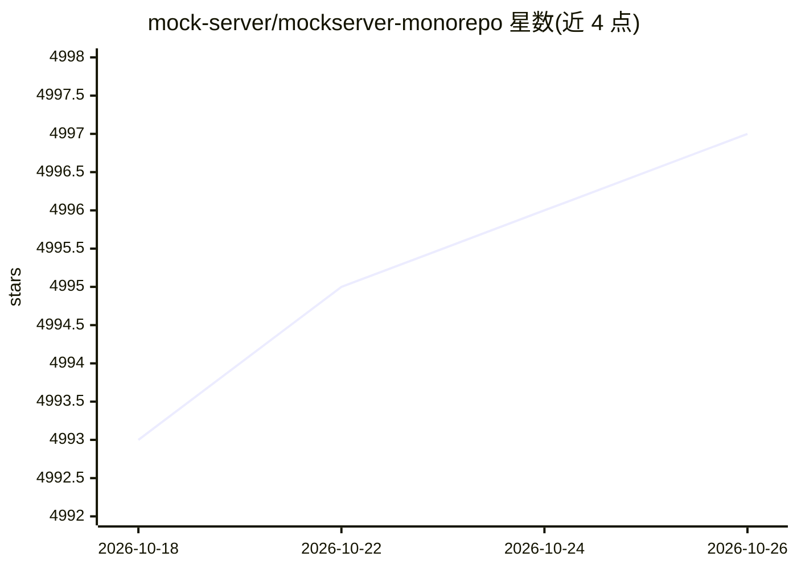

# mock-server/mockserver-monorepo

⭐ 4,997 · Java · Apache-2.0 · 推送 2026-10-25 · [GitHub](https://github.com/mock-server/mockserver-monorepo) · [官网](https://www.mock-server.com) · 个人维护

**测试用 HTTP(S) mock 服务器与代理，支持 mock AI/LLM API**

用于测试的 mock 服务器与代理：在单端口自动识别 HTTP/1.1、HTTPS、HTTP/2、gRPC、WebSockets 与 TCP，可返回固定/模板化/回调响应，或作为代理记录、检查、修改真实流量，并可注入延迟、断连与错误做混沌测试。面向需要隔离外部依赖的开发与测试场景，支持从 OpenAPI/Swagger 规范生成 mock，并提供 Java 17+、Docker、Helm/Kubernetes、Homebrew、npm 等多种运行方式与多语言客户端库。AI 相关能力包括 mock OpenAI/Anthropic/Gemini/Bedrock/Azure OpenAI/Ollama 的 chat-completion API（含流式）及内置 MCP 服务器供 AI 编码助手驱动。官方声明仅作为开发与测试工具使用。

## 筛选速览

| 维度 | 判定 | 备注 |
|---|---|---|
| AI 角色 | `ai-enhanced` | 去掉 AI 部分产品仍成立 |
| 许可风险 | `permissive` | Apache-2.0 |
| 部署形态 | `self-host` | docker 或自建部署 |
| 模型依赖 | — | README 未给出锁定关系 |
| 硬件要求 | — | 无带数字的原话,不猜 |
| 安装摩擦 | `low` | 无编译、无系统依赖或容器化 |
| 成熟度 | — | 结构信号不足 |

## 能力要点

- 单端口自动识别 HTTP/1.1、HTTP/2、gRPC/Web、WebSockets、TCP 等协议
- 代理模式下记录、检查、修改真实流量，含 TLS 加密交换可见性
- 注入延迟、断连、错误的内置混沌工程能力
- mock OpenAI/Anthropic/Gemini/Bedrock/Azure OpenAI/Ollama chat-completion API 并内置 MCP 服务器

## 适用场景

- 在集成测试中 mock 应用依赖的 HTTP(S) 或 LLM API，隔离外部服务
- 作为代理录制并回放真实 API 流量
- 通过注入故障验证应用在依赖异常时的表现
- 让 AI 编码助手通过内置 MCP 服务器直接操作 MockServer

## 场景标签

 · 领域:软件开发/测试工具

## 证据(README 行号)

> L7: **MockServer mocks, records, and chaos-tests any HTTP(S) dependency your application talks to — one binary, no per-p
> L14: - **Mock AI too** — chat-completion APIs for OpenAI, Anthropic, Gemini, Bedrock, Azure OpenAI and Ollama (including

## 星数曲线

2026-10-18 4,993 → 2026-10-26 4,997（+4）

---
*卡片 v1 · prompt 1.4 · 生成 2026-10-20 · 置信度 mid · 依据 README sha `8a37807b3b33` · [字段定义](../../DATASET.md)*
