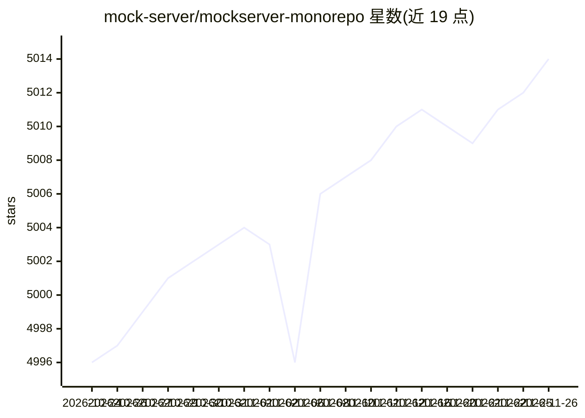

# mock-server/mockserver-monorepo

⭐ 5,014 · Java · Apache-2.0 · 推送 2026-11-24 · [GitHub](https://github.com/mock-server/mockserver-monorepo) · [官网](https://www.mock-server.com) · 个人维护

**面向开发者的 HTTP(S) mock 服务器与代理，支持 mock AI API**

一个二进制的 HTTP(S) mock 服务器与代理，用于测试：可返回预置/模板/回调响应，或作为代理记录、检查、修改真实流量，并可注入延迟与错误做混沌测试。单端口自动识别 HTTP/1.1、HTTP/2、gRPC、WebSockets、TCP，另有实验性 HTTP/3、Kafka/MQTT 异步测试。AI 相关：提供 OpenAI/Anthropic/Gemini/Bedrock/Azure OpenAI/Ollama 聊天补全 API 的 mock，并内置 MCP 服务器供 AI 编码助手驱动。支持从 OpenAPI 规范生成 mock，运行方式含 Docker、Homebrew、Helm、JAR/WAR。

## 筛选速览

| 维度 | 判定 | 备注 |
|---|---|---|
| AI 角色 | `ai-enhanced` | 去掉 AI 部分产品仍成立 |
| 许可风险 | `permissive` | Apache-2.0 |
| 部署形态 | `self-host` | docker 或自建部署 |
| 模型依赖 | local-ok | 支持本地模型 |
| 硬件要求 | — | 无带数字的原话,不猜 |
| 安装摩擦 | `low` | 无编译、无系统依赖或容器化 |
| 成熟度 | — | 结构信号不足 |

## 能力要点

- 单端口自动识别多协议：HTTP/1.1/2、gRPC、WebSockets、TCP
- 提供主流聊天补全 API（OpenAI/Anthropic/Gemini/Bedrock/Azure OpenAI/Ollama）的 mock 与流式响应
- 内置 MCP 服务器，AI 编码助手可直接驱动
- 从 OpenAPI/Swagger 规范生成 mock，支持混沌注入

## 适用场景

- 在依赖方不可用时 mock 上游 API 进行开发与测试
- 通过记录/回放代理检查和修改真实流量
- 注入延迟、断连、错误验证应用的容错表现
- 为依赖 LLM API 的应用提供确定性 mock 测试

## 场景标签

 · 领域:开发测试工具

## 证据(README 行号)

> L8: **MockServer mocks, records, and chaos-tests any HTTP(S) dependency your application talks to — one binary, no per-p
> L15: - **Mock AI too** — chat-completion APIs for OpenAI, Anthropic, Gemini, Bedrock, Azure OpenAI and Ollama (including
> L17: - **Fits your stack** — Java, JavaScript/Node, Python, Ruby, Go, .NET, Rust, and PHP clients, plus JUnit and Spring

## 星数曲线

2026-10-24 4,996 → 2026-11-26 5,014（+18）

---
*卡片 v1 · prompt 1.4 · 生成 2026-11-22 · 置信度 mid · 依据 README sha `b9787ca1257c` · [字段定义](../../DATASET.md)*
