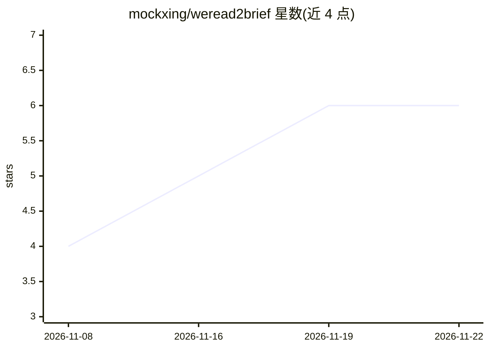

# mockxing/weread2brief

⭐ 6 · Python · MIT · 推送 2026-10-19 · [GitHub](https://github.com/mockxing/weread2brief) · 个人维护 · 中文 README

**把微信读书书架里的公众号文章抓取并提炼成每日简报**

以 WorkBuddy Skill 形态分发的自动化工具：用户先把关注的公众号手动加入微信读书书架，随后通过 Chrome CDP 持久登录态抓取书架内公众号的最新文章全文，按 URL 或（标题+日期）双键去重归档为 Markdown，再由 agent 按模板生成每日简报，支持定时执行与写入 ima/Notion/Obsidian/本地。验证码默认由人工点选，也支持图片点选链式自动处理。限制：只能抓书架内账号，扫码需真人，不能云端无人值守，平台改版会失效。

## 筛选速览

| 维度 | 判定 | 备注 |
|---|---|---|
| AI 角色 | `ai-native` | 本体是模型或模型工具 |
| 许可风险 | `permissive` | MIT |
| 部署形态 | `desktop` | 安装包/桌面程序 |
| 模型依赖 | — | README 未给出锁定关系 |
| 硬件要求 | — | 无带数字的原话,不猜 |
| 安装摩擦 | `low` | 无编译、无系统依赖或容器化 |
| 成熟度 | — | 结构信号不足 |

## 能力要点

- 从微信读书书架批量抓取公众号文章全文并双键去重归档
- agent 判读页面状态与验证码，支持最多 4 轮链式点选
- 生成强制带发布日期与原文链接的结构化 Markdown 简报
- 支持定时任务与 ima / Notion / Obsidian 多端同步

## 适用场景

- 每天早上自动把自己关注的公众号文章整理成一页简报
- 归档已关注公众号的文章供个人阅读与研究
- 替代逐个点开公众号滑标题的高成本筛选流程

## 场景标签

`浏览器自动化` `网页抓取` `AI 写作` · 领域:效率与自动化

## 证据(README 行号)

> L34: **它不替你判断，它替你把材料摆好。**
> L63: |**简报生成**|按模板产出结构化 Markdown，强制带发布日期与原文链接|
> L181: 5. **判断交给 agent，规则写进文档**

## 星数曲线

2026-11-08 4 → 2026-11-22 6（+2）

---
*卡片 v1 · prompt 1.4 · 生成 2026-11-20 · 置信度 high · 依据 README sha `a83043afdd5a` · [字段定义](../../DATASET.md)*
