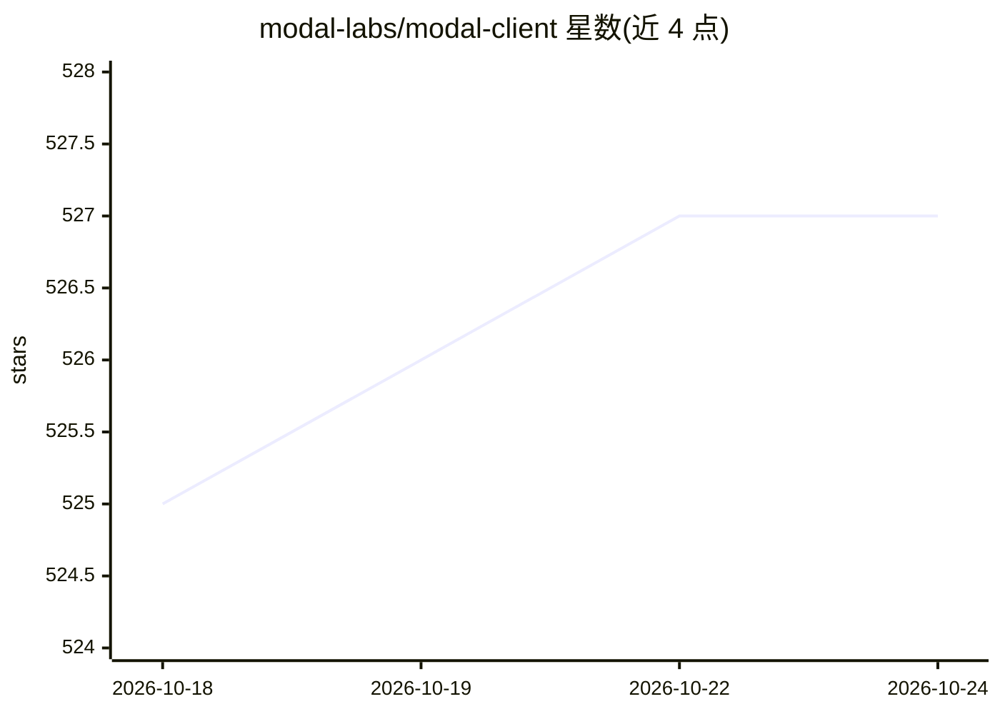

# modal-labs/modal-client

⭐ 527 · Python · Apache-2.0 · 推送 2026-10-23 · [GitHub](https://github.com/modal-labs/modal-client) · [官网](https://modal.com/docs) · 组织维护

**Modal 官方 SDK 仓库：部署无服务器应用并操作 Modal 平台**

包含 Modal 官方多语言 SDK 源码：Python SDK 支持部署高性能无服务器应用并以编程方式操作 Modal 平台，附带 modal CLI；JS/TypeScript 与 Go SDK 支持 Modal Sandboxes、调用已部署的 Modal Functions 及部分平台资源。另提供面向编码 agent 的官方技能，可经 modal CLI 或 npx skills 安装，前者附带版本对齐的参考文档。用法问题通过 Modal Slack 与在线文档支持。

## 筛选速览

| 维度 | 判定 | 备注 |
|---|---|---|
| AI 角色 | `ai-ecosystem` | LLM/agent 周边工具 |
| 许可风险 | `permissive` | Apache-2.0 |
| 部署形态 | `library` | 以包/库形式分发 |
| 模型依赖 | — | README 未给出锁定关系 |
| 硬件要求 | — | 无带数字的原话,不猜 |
| 安装摩擦 | `low` | 无编译、无系统依赖或容器化 |
| 成熟度 | — | 结构信号不足 |

## 能力要点

- Python SDK 部署无服务器应用并操作 Modal 平台
- JS/TypeScript 与 Go SDK 支持 Sandboxes 与调用 Modal Functions
- 包含 modal CLI，可独立安装
- 官方编码 agent 技能经 CLI 安装并附版本对齐文档

## 适用场景

- 用 Python 将计算任务部署到 Modal 无服务器平台
- 从 JS/Go 调用部署在 Modal 上的函数
- 为编码 agent 安装 Modal 官方技能

## 场景标签

 · 领域:云/无服务器计算基础设施

## 证据(README 行号)

> L5: This repository contains the source code for Modal's official SDKs.
> L15: The Modal Python SDK allows you to deploy high-performance serverless applications and programmatically interact wi
> L36: The JS and Go SDKs allow you to use Modal Sandboxes, invoke deployed Modal Functions, and interact with some Modal 

## 星数曲线

2026-10-18 525 → 2026-10-24 527（+2）

---
*卡片 v1 · prompt 1.4 · 生成 2026-10-21 · 置信度 mid · 依据 README sha `2c0ae67f31ce` · [字段定义](../../DATASET.md)*
