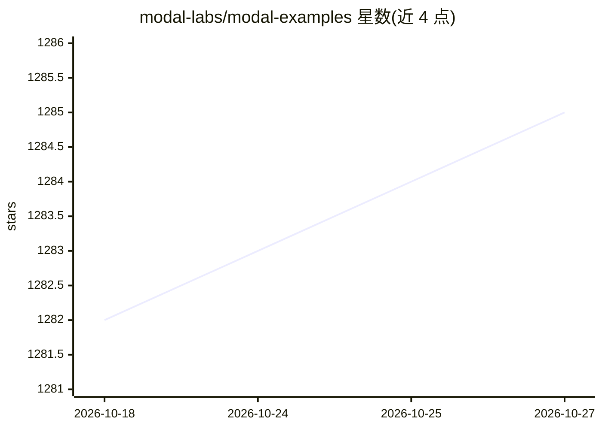

# modal-labs/modal-examples

⭐ 1,285 · Python · MIT · 推送 2026-10-26 · [GitHub](https://github.com/modal-labs/modal-examples) · [官网](https://modal.com/docs) · 组织维护

**Modal 云平台的官方示例程序集合**

Modal 官方维护的示例代码库，按类别组织为编号文件夹（01_getting_started 到 14_clusters 及 misc），覆盖 Modal 的概念与能力导览，主题含 GPU、机器学习、PyTorch、Stable Diffusion、serverless 等。本地运行脚本后由 Modal 云端按需启动 serverless 容器执行。示例针对 Python 3.11 持续测试正确性，需注册 Modal 账号并安装 modal 包、设置 API key。MIT 许可。

## 筛选速览

| 维度 | 判定 | 备注 |
|---|---|---|
| AI 角色 | `ai-knowledge` | 知识聚合/清单类 |
| 许可风险 | `permissive` | MIT |
| 部署形态 | `None` |  |
| 模型依赖 | — | README 未给出锁定关系 |
| 硬件要求 | — | 无带数字的原话,不猜 |
| 安装摩擦 | `low` | 无编译、无系统依赖或容器化 |
| 成熟度 | — | 结构信号不足 |

## 能力要点

- 按类别组织的编号文件夹提供 Modal 概念与能力导览
- 本地命令触发云端按需启动 serverless 容器
- 示例针对 Python 3.11 持续做正确性测试

## 适用场景

- 学习 Modal 平台并搭建自己的云端应用
- 查找 GPU/机器学习/PyTorch 等场景的参考实现

## 场景标签

`教程课程` · 领域:学习与行业

## 证据(README 行号)

> L6: This is a collection of examples for Modal. Use these examples to learn Modal and build your own robust and scalable
> L26: - **`01_getting_started/`** through **`14_clusters/`** provide a guided tour through Modal's concepts and capabilit

## 星数曲线

2026-10-18 1,282 → 2026-10-27 1,285（+3）

---
*卡片 v1 · prompt 1.4 · 生成 2026-10-21 · 置信度 high · 依据 README sha `76eec7d2cf66` · [字段定义](../../DATASET.md)*
