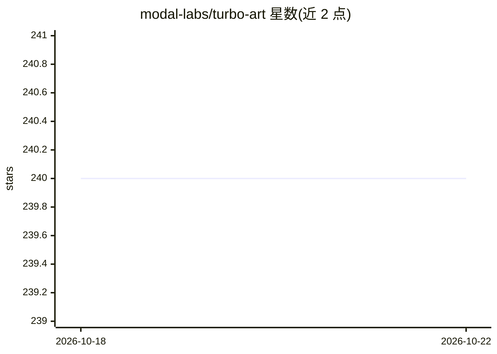

# modal-labs/turbo-art

⭐ 240 · Svelte · 推送 2025-11-19 · [GitHub](https://github.com/modal-labs/turbo-art) · [官网](https://turbo.art/) · 组织维护

**基于 SDXL Turbo 的实时图像编辑创意实验场**

由 Modal Labs 维护的创意探索 playground：使用 SDXL Turbo 模型进行实时图像编辑，整个应用以 serverless 方式托管在 Modal 平台上。架构由两部分组成：turbo_art.py（少于 150 行代码，包含模型端点与 FastAPI Web 服务器）和 src/ 目录下的 Svelte 前端。本地开发需要安装 Modal、FastAPI 与 npm，通过 modal serve 热更新迭代，用 modal deploy 部署；不使用时 Modal 应用缩容至 0，闲置不计费。

## 筛选速览

| 维度 | 判定 | 备注 |
|---|---|---|
| AI 角色 | `ai-native` | 本体是模型或模型工具 |
| 许可风险 | `none` | — |
| 部署形态 | `library` | 以包/库形式分发 |
| 模型依赖 | — | README 未给出锁定关系 |
| 硬件要求 | — | 无带数字的原话,不猜 |
| 安装摩擦 | `low` | 无编译、无系统依赖或容器化 |
| 成熟度 | — | 结构信号不足 |

## 能力要点

- SDXL Turbo 实时图像编辑
- 全应用 serverless 托管于 Modal，闲置缩容至 0
- 后端模型端点+FastAPI 服务器少于 150 行代码
- Svelte 前端与 Modal 热更新开发流程

## 适用场景

- 在线进行实时的创意图像编辑实验
- 学习如何用 Modal 部署 SDXL 模型推理服务
- 参考前后端结合的 serverless AI 应用结构

## 场景标签

`图像生成` · 领域:内容生成

## 证据(README 行号)

> L3: A playground for creative exploration that uses SDXL Turbo for real-time image editing. Try it now at https://turbo.
> L7: The entire app is serverless and hosted on Modal.

## 星数曲线

2026-10-18 240 → 2026-10-22 240（+0）

---
*卡片 v1 · prompt 1.4 · 生成 2026-10-22 · 置信度 high · 依据 README sha `adc11453c45d` · [字段定义](../../DATASET.md)*
