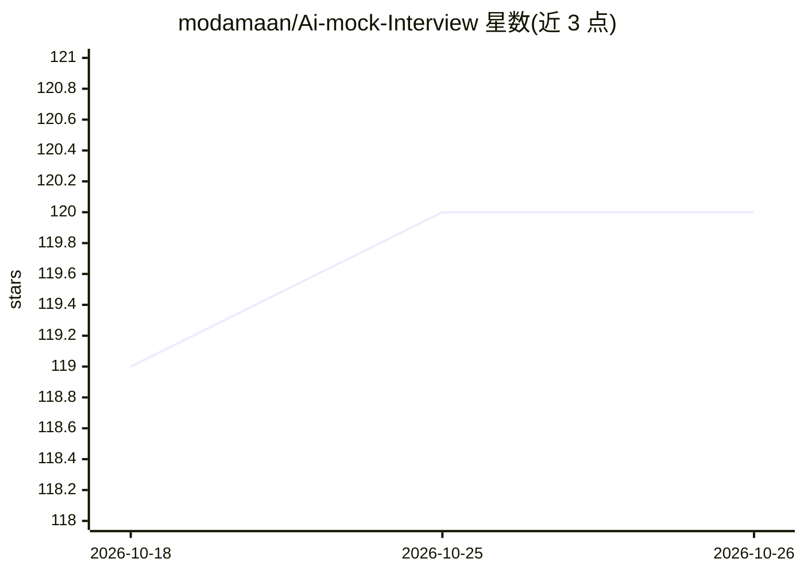

# modamaan/Ai-mock-Interview

⭐ 120 · JavaScript · 推送 2026-07-29 · [GitHub](https://github.com/modamaan/Ai-mock-Interview) · [官网](https://mockinterview-platform.vercel.app) · 个人维护

**求职者的 AI 模拟面试平台：AI 出题并反馈评分**

基于 Next.js、Tailwind CSS、Gemini API、PostgreSQL（Neon Serverless）与 Drizzle ORM 构建的模拟面试 Web 应用，面向求职者。用户注册后选择面试类型（技术/行为）与职位，系统按角色、行业与经验等级生成问题；面试结束后提供详细反馈、优势与改进建议、总评分，并在首页展示最近面试记录。需克隆源码并通过 npm/yarn 安装依赖后本地运行，访问 localhost:3000 使用。

## 筛选速览

| 维度 | 判定 | 备注 |
|---|---|---|
| AI 角色 | `ai-native` | 本体是模型或模型工具 |
| 许可风险 | `none` | — |
| 部署形态 | `library` | 以包/库形式分发 |
| 模型依赖 | — | README 未给出锁定关系 |
| 硬件要求 | — | 无带数字的原话,不猜 |
| 安装摩擦 | `low` | 无编译、无系统依赖或容器化 |
| 成熟度 | — | 结构信号不足 |

## 能力要点

- AI 驱动的面试提问与反馈
- 按职位角色、行业与经验等级调整问题
- 面试后输出详细反馈与总评分
- 首页可回顾最近面试记录

## 适用场景

- 我想在求职前针对目标岗位练习面试
- 希望获得面试表现的详细反馈与改进建议
- 按自己的经验水平练习合适难度的题目

## 场景标签

`AI 助手` · 领域:对话与助手

## 证据(README 行号)

> L11: This is an advanced and interactive AI-powered mock interview platform designed to help job seekers practice and im
> L14: - AI-driven Interview: interview questions and feedback powered by AI.

## 星数曲线

2026-10-18 119 → 2026-10-26 120（+1）

---
*卡片 v1 · prompt 1.4 · 生成 2026-10-23 · 置信度 high · 依据 README sha `77a70bb31cd7` · [字段定义](../../DATASET.md)*
