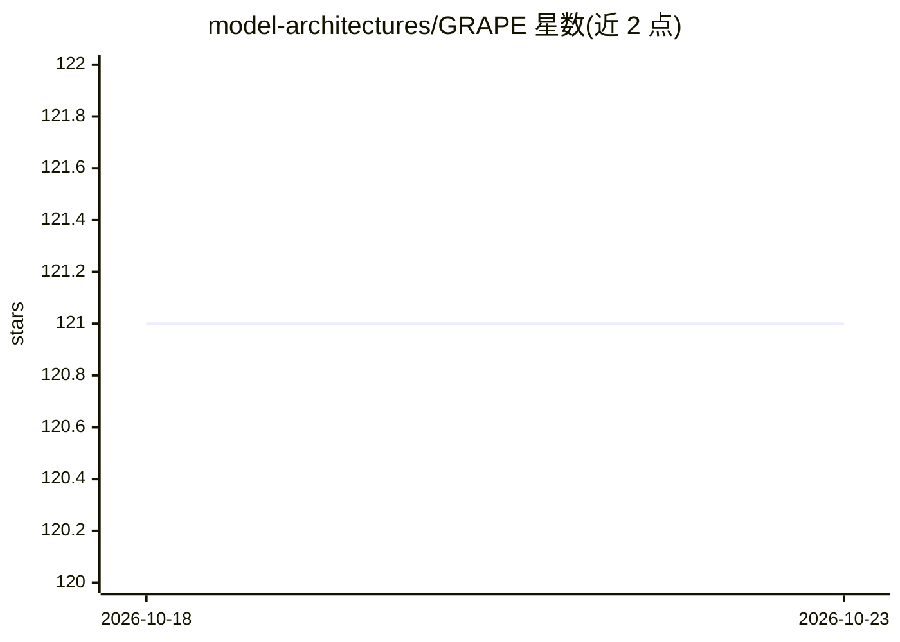

# model-architectures/GRAPE

⭐ 121 · Python · Apache-2.0 · 推送 2026-06-15 · [GitHub](https://github.com/model-architectures/GRAPE) · [官网](https://model-architectures.github.io/GRAPE/) · 组织维护

**统一群论位置编码框架的预训练研究代码（ICLR 2026）**

ICLR 2026 论文 GRAPE 的官方实现：以群作用（SO(d) 旋转与 GL(d+k) 幺负提升）统一乘性（RoPE）与加性（ALiBi、FoX）位置编码机制，保证精确相对位置律与流式缓存。基于 nanoGPT 代码库，提供多 GPU 分布式预训练脚本（torchrun），支持 Fineweb-Edu-100B 与 OpenWebText 数据准备，集成 lm-evaluation-harness 做基准评测，并提供数据顺序与逐位确定性的复现选项。面向需要训练与评测位置编码变体的研究人员，硬件门槛为至少 8×80G 显存。

## 筛选速览

| 维度 | 判定 | 备注 |
|---|---|---|
| AI 角色 | `ai-ecosystem` | LLM/agent 周边工具 |
| 许可风险 | `permissive` | Apache-2.0 |
| 部署形态 | `library` | 以包/库形式分发 |
| 模型依赖 | — | README 未给出锁定关系 |
| 硬件要求 | `gpu-24g` | |
| 安装摩擦 | `medium` | 含编译或系统依赖之一 |
| 成熟度 | — | 结构信号不足 |

## 能力要点

- SO(d)/GL(d+k) 群论框架统一 RoPE、ALiBi、FoX 等位置编码
- 分布式预训练脚本（torchrun，8 GPU 配置）
- stateless/stateful 数据 RNG 与逐位确定性训练选项
- 集成 lm-evaluation-harness 的 7 任务评测

## 适用场景

- 在 FineWeb-Edu-100B 上预训练并对比不同位置编码
- 复现论文中 355M/770M 模型的评测结果
- 研究新的群论位置编码变体

## 场景标签

`模型训练` · 领域:训练与推理

## 证据(README 行号)

> L11: GRAPE is a unified group-theoretic framework for positional encoding that subsumes multiplicative mechanisms (like 
> L116: Pretrain the GRAPE and other models using the prepared datasets. The provided scripts support distributed training
> L169: - Karpathy’s nanoGPT provides the foundational codebase upon which this repo is built.

## 星数曲线

2026-10-18 121 → 2026-10-23 121（+0）

---
*卡片 v1 · prompt 1.4 · 生成 2026-10-23 · 置信度 mid · 依据 README sha `081655173644` · [字段定义](../../DATASET.md)*
