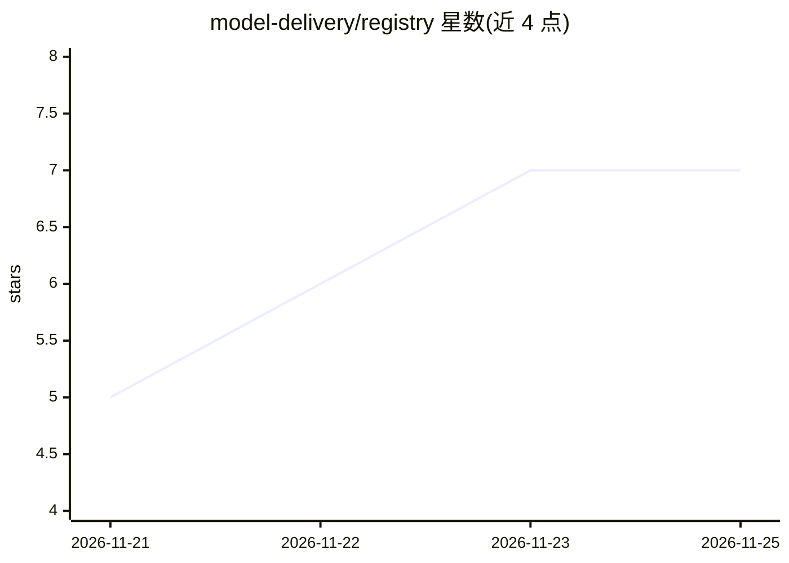

# model-delivery/registry

⭐ 7 · Go · Apache-2.0 · 推送 2026-11-20 · [GitHub](https://github.com/model-delivery/registry) · [官网](https://model.delivery) · 组织维护

**自托管模型注册表：镜像一次，从自有基础设施向 HF 客户端提供下载**

面向 AI 模型与数据集的自托管注册表，角色类似面向模型文件的 Docker registry/Artifactory：可从 Hugging Face 镜像仓库或推送自有模型，经 HF 兼容 API 提供下载与上传。基于 huggingface_hub 的工具（transformers、diffusers、hf CLI）改一个环境变量 HF_ENDPOINT 即可使用。单二进制交付，元数据存 SQLite，模型文件存本地磁盘或 S3 兼容对象存储；提供镜像、按需拉取缓存、版本管理、SHA-256 校验、访问令牌、备份、Prometheus 指标与 Web UI。

## 筛选速览

| 维度 | 判定 | 备注 |
|---|---|---|
| AI 角色 | `ai-ecosystem` | LLM/agent 周边工具 |
| 许可风险 | `permissive` | Apache-2.0 |
| 部署形态 | `desktop` | 安装包/桌面程序 |
| 模型依赖 | — | README 未给出锁定关系 |
| 硬件要求 | — | 无带数字的原话,不猜 |
| 安装摩擦 | `low` | 无编译、无系统依赖或容器化 |
| 成熟度 | `idea` | |

## 能力要点

- HF 兼容 API：现有 huggingface_hub 客户端改一个环境变量即可接入
- 定时同步跟进上游仓库、按需 pull-through 缓存、版本不可变
- SHA-256 内容寻址存储与校验，文件跨仓库去重
- 单二进制+SQLite 开箱即用，可选 S3 兼容存储与签名 URL 重定向

## 适用场景

- 在企业内网搭建模型仓库，断网后分发已镜像的模型
-  gated/私有仓库用自有 token 镜像到自有基础设施
- 为 CI 流水线提供模型下载与上传的自托管端点
- 用 Prometheus 监控模型仓库的缓存命中率与备份状态

## 场景标签

 · 领域:MLOps/模型基础设施

## 证据(README 行号)

> L7: Think of a Docker registry or Artifactory, built for model files. Mirror
> L17: It is one binary. Out of the box it needs nothing else: metadata in SQLite,

## 星数曲线

2026-11-21 5 → 2026-11-25 7（+2）

---
*卡片 v1 · prompt 1.4 · 生成 2026-11-21 · 置信度 high · 依据 README sha `53e900826f06` · [字段定义](../../DATASET.md)*
