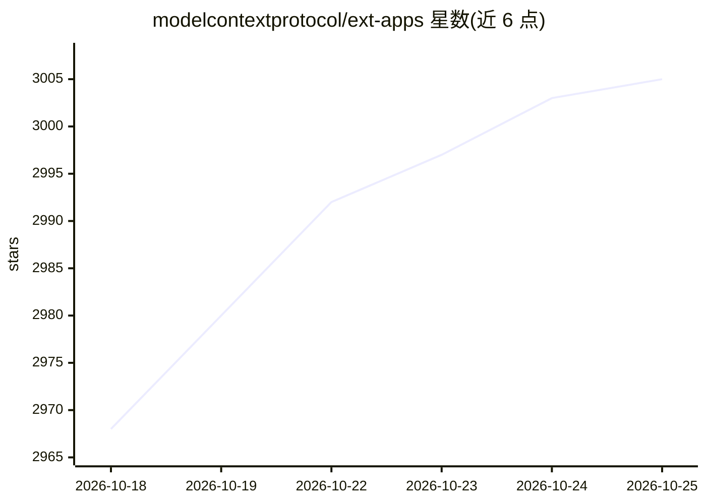

# modelcontextprotocol/ext-apps

⭐ 3,007 · TypeScript · NOASSERTION · 推送 2026-10-23 · [GitHub](https://github.com/modelcontextprotocol/ext-apps) · [官网](https://apps.extensions.modelcontextprotocol.io/) · 组织维护

**MCP Apps 协议规范与 SDK：让 MCP 工具在聊天客户端内渲染交互 UI**

Model Context Protocol 官方的扩展协议仓库，包含 MCP Apps 规范与 TypeScript SDK：允许 MCP 工具声明 ui:// HTML 资源，由宿主客户端在对话内以沙箱 iframe 渲染图表、表单、仪表盘等交互界面，并通过通知与工具调用双向通信。SDK 面向三类角色——应用开发者（构建 View）、宿主开发者（嵌入 View）、MCP 服务器作者（注册带 UI 元数据的工具）。要求 Node.js 20+，附参考宿主 basic-host、多个示例与四个 Agent Skills 用于脚手架生成与迁移。

## 筛选速览

| 维度 | 判定 | 备注 |
|---|---|---|
| AI 角色 | `ai-ecosystem` | LLM/agent 周边工具 |
| 许可风险 | `permissive` | NOASSERTION |
| 部署形态 | `library` | 以包/库形式分发 |
| 模型依赖 | — | README 未给出锁定关系 |
| 硬件要求 | — | 无带数字的原话,不猜 |
| 安装摩擦 | `low` | 无编译、无系统依赖或容器化 |
| 成熟度 | — | 结构信号不足 |

## 能力要点

- 工具声明 ui:// 资源，宿主在沙箱 iframe 中内联渲染交互 UI
- 四包 SDK 覆盖 View 构建、React hooks、宿主桥接与服务器注册
- 四个 Agent Skills 支持新建、从 OpenAI Apps 迁移、为 MCP 服务器加 UI、Web 应用混合化
- 规范含 2026-01-26 稳定版与草案版

## 适用场景

- 为我的 MCP 服务器工具添加内联交互界面（图表、表单、画布）
- 在我的聊天客户端中嵌入并渲染 MCP Apps View
- 把现有 Web 应用转换为混合 web + MCP App

## 场景标签

 · 领域:LLM 基础设施/MCP 协议

## 证据(README 行号)

> L83: MCP Apps provide a standardized way to deliver interactive UIs from MCP servers.
> L88: MCP Apps extend the Model Context Protocol by letting tools declare UI
> L135: The SDK serves three roles: app developers building interactive Views, host

## 星数曲线

2026-10-18 2,968 → 2026-10-25 3,005（+37）

---
*卡片 v1 · prompt 1.4 · 生成 2026-10-20 · 置信度 high · 依据 README sha `6d4cc29ad2f5` · [字段定义](../../DATASET.md)*
