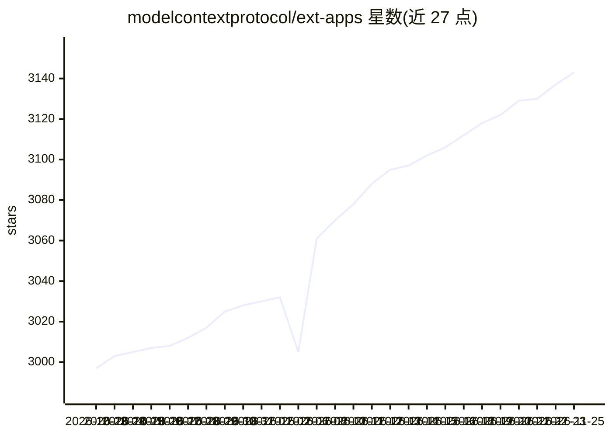

# modelcontextprotocol/ext-apps

⭐ 3,143 · TypeScript · NOASSERTION · 推送 2026-11-10 · [GitHub](https://github.com/modelcontextprotocol/ext-apps) · [官网](https://apps.extensions.modelcontextprotocol.io/) · 组织维护

**为 MCP 工具构建内嵌聊天界面交互 UI 的协议规范与 SDK**

MCP Apps 是 MCP 协议的扩展规范与配套 SDK，用于让 MCP 工具通过 `ui://` 资源声明交互式界面（图表、表单、仪表盘等），在支持规范的宿主客户端中以沙箱 iframe 内联渲染，并与宿主双向通信、调用其他工具。面向三类角色：构建 View 的应用开发者、嵌入 View 的宿主开发者、注册带 UI 元数据工具的 MCP 服务器作者。仓库附带四个 Agent Skills 供 AI 编码代理脚手架或迁移应用，示例可用 basic-host 参考宿主或 stdio 客户端运行。

## 筛选速览

| 维度 | 判定 | 备注 |
|---|---|---|
| AI 角色 | `ai-ecosystem` | LLM/agent 周边工具 |
| 许可风险 | `permissive` | NOASSERTION |
| 部署形态 | `library` | 以包/库形式分发 |
| 模型依赖 | — | README 未给出锁定关系 |
| 硬件要求 | — | 无带数字的原话,不猜 |
| 安装摩擦 | `low` | 无编译、无系统依赖或容器化 |
| 成熟度 | — | 结构信号不足 |

## 能力要点

- tools 通过 ui:// 资源声明 HTML 界面，宿主以沙箱 iframe 渲染
- SDK 覆盖 View 构建（App 类、React hooks）、宿主嵌入（app-bridge）、服务器端工具注册
- 提供 4 个 Agent Skills（create-mcp-app / migrate-oai-app / add-app-to-server / convert-web-app）
- 含规范文档（2026-01-26 Stable 与 draft 版本）及多种示例应用与多框架模板

## 适用场景

- 为 MCP 服务器工具添加可在聊天中内联渲染的图表/表单 UI
- 在支持规范的宿主客户端中嵌入第三方工具的交互界面
- 借助 AI 编码代理脚手架新的 MCP App 或迁移现有 Web/OpenAI App

## 场景标签

`Agent 框架` · 领域:Agent 开发

## 证据(README 行号)

> L83: MCP Apps provide a standardized way to deliver interactive UIs from MCP servers.
> L135: The SDK serves three roles: app developers building interactive Views, host
> L101: Requires Node.js 20+. The base MCP SDK packages are `^2.0.0` peers of

## 星数曲线

2026-10-23 2,997 → 2026-11-25 3,143（+146）

---
*卡片 v1 · prompt 1.4 · 生成 2026-11-23 · 置信度 high · 依据 README sha `86f2bed2d5d6` · [字段定义](../../DATASET.md)*
