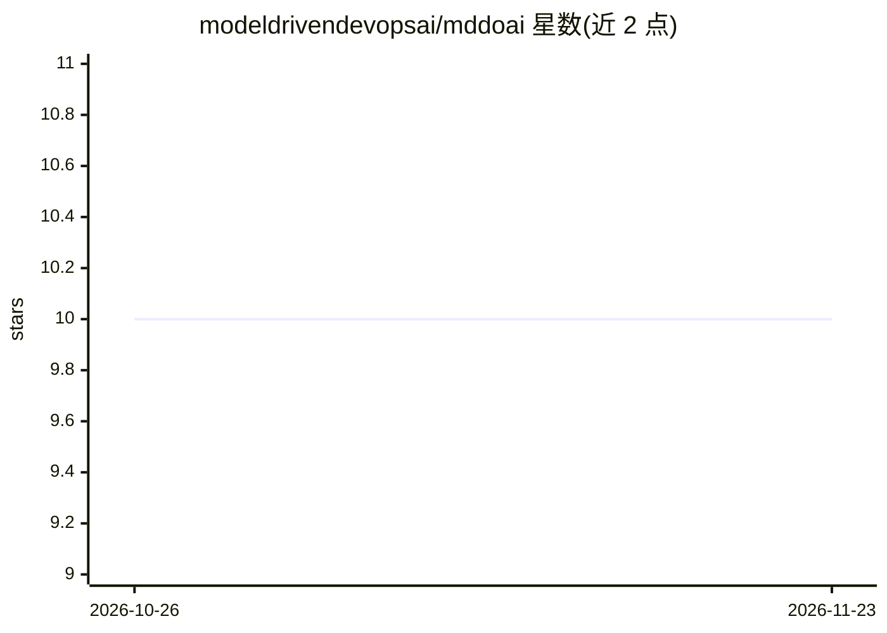

# modeldrivendevopsai/mddoai

⭐ 10 · Java · EPL-2.0 · 推送 2026-11-22 · [GitHub](https://github.com/modeldrivendevopsai/mddoai) · [官网](https://mddoai.com) · 组织维护

**从软件架构模型自动生成 GitLab CI/CD 流水线的工具**

MDDOAI 将软件架构模型（.swarch/.pim/.gitlabpsm）经模型驱动转换生成可部署的 .gitlab-ci.yml，提供 swarch2gitlab、pim2gitlab、psm2gitlab 三种转换命令。基于 EMF、Acceleo、ATL、Epsilon 等 Eclipse 建模组件实现模型到文本/模型到模型的转换，以 CLI 形式运行。提供 Docker 镜像（约 2 分钟上手）与源码构建（需 Java 21、Gradle）两种使用方式，支持三级 Docker 镜像版本策略。AI 用于开发流程（Copilot 代理做 PR 审查、测试生成）与发布说明生成。

## 筛选速览

| 维度 | 判定 | 备注 |
|---|---|---|
| AI 角色 | `ai-enhanced` | 去掉 AI 部分产品仍成立 |
| 许可风险 | `viral` | EPL-2.0 |
| 部署形态 | `self-host` | docker 或自建部署 |
| 模型依赖 | — | README 未给出锁定关系 |
| 硬件要求 | — | 无带数字的原话,不猜 |
| 安装摩擦 | `low` | 无编译、无系统依赖或容器化 |
| 成熟度 | — | 结构信号不足 |

## 能力要点

- 从 .swarch/.pim/.gitlabpsm 模型生成 .gitlab-ci.yml 的三种转换命令
- Docker 镜像开箱即用，输出目录挂载即可获得流水线文件
- 基于 EMF/Acceleo/ATL/Epsilon 的模型驱动转换引擎
- 三级 Docker 镜像标签策略（snapshot/稳定版）与自动化 Release 工作流

## 适用场景

- 从既有软件架构模型一键生成 GitLab CI/CD 配置
- 在 CI 流水线中调用容器化转换命令批量生成流水线文件
- 定制 Acceleo 模板以适配团队的流水线生成规范

## 场景标签

 · 领域:DevOps/软件工程工具

## 证据(README 行号)

> L3: This project transforms Software Architecture models into usable CI/CD pipelines using model-driven techniques.
> L11: MDDOAI automatically generates GitLab CI/CD pipeline configurations from software architecture models:
> L404: ## AI Agents

## 星数曲线

2026-10-26 10 → 2026-11-23 10（+0）

---
*卡片 v1 · prompt 1.4 · 生成 2026-11-19 · 置信度 high · 依据 README sha `3b6bf912d60a` · [字段定义](../../DATASET.md)*
