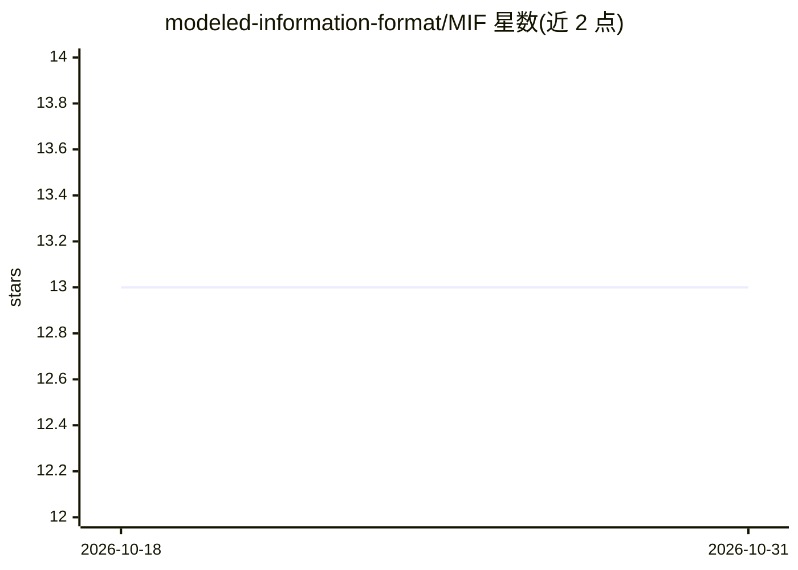

# modeled-information-format/MIF

⭐ 13 · Python · MIT · 推送 2026-10-30 · [GitHub](https://github.com/modeled-information-format/MIF) · [官网](https://mif-spec.dev/) · 个人维护

**AI 知识可移植交换的开放内容格式规范（Markdown+JSON-LD）**

MIF（Modeled Information Format）是一个 MIT 许可的开放规范，为 OKF 目录信封补充具体内容模型：Markdown 为规范表示，JSON-LD 为派生投影，由脚本再生。定义 semantic/episodic/procedural 三类知识类型、类型化关系、双时间有效性、来源与信任层级（可选 W3C PROV 对齐层）、27 个顶层属性分三级一致性。AI Memory 是其首个领域 profile，含 Mem0/Zep/Letta 等迁移指南；提供转换、校验与迁移脚本，面向构建可移植 AI 记忆/知识库的开发者。

## 筛选速览

| 维度 | 判定 | 备注 |
|---|---|---|
| AI 角色 | `ai-ecosystem` | LLM/agent 周边工具 |
| 许可风险 | `permissive` | MIT |
| 部署形态 | `None` |  |
| 模型依赖 | — | README 未给出锁定关系 |
| 硬件要求 | — | 无带数字的原话,不猜 |
| 安装摩擦 | `low` | 无编译、无系统依赖或容器化 |
| 成熟度 | — | 结构信号不足 |

## 能力要点

- Markdown 规范表示 + 可再生 JSON-LD 投影的双格式
- semantic/episodic/procedural 三类知识分类与类型化关系
- 双时间跟踪、validity 窗口与 TTL/新鲜度语义
- OKF 兼容是超集关系：每个 MIF bundle 均通过 OKF 校验

## 适用场景

- 为 AI 记忆系统定义可移植的内容模型与来源信任语义
- 在 Markdown 与 JSON-LD 之间做无损往返转换与校验
- 从 Mem0/Zep/Letta 等记忆系统迁移到统一格式

## 场景标签

`Agent 记忆` `知识图谱` · 领域:Agent 开发

## 证据(README 行号)

> L18: model* open. MIF supplies the concrete type system, typed relationships,
> L27: bundle**. Markdown is the canonical representation; JSON-LD is a derived,
> L205: Memory-specific material — forgetting-curve decay tuning, episodic *session*

## 星数曲线

2026-10-18 13 → 2026-10-31 13（+0）

---
*卡片 v1 · prompt 1.4 · 生成 2026-10-31 · 置信度 high · 依据 README sha `46ca7d865885` · [字段定义](../../DATASET.md)*
