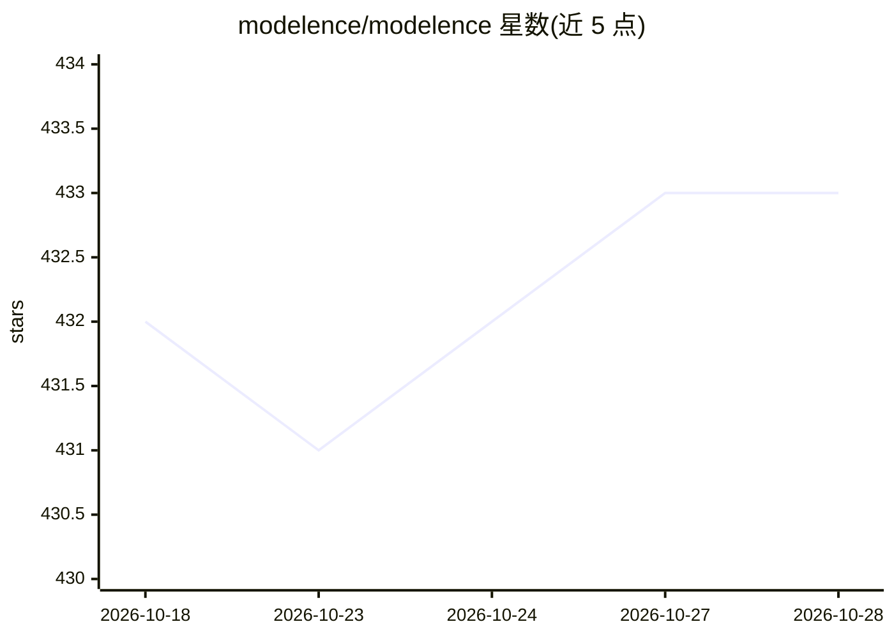

# modelence/modelence

⭐ 433 · TypeScript · NOASSERTION · 推送 2026-10-28 · [GitHub](https://github.com/modelence/modelence) · [官网](https://modelence.com) · 组织维护

**构建生产级全栈 Web 应用的框架与云端平台**

面向 Web 开发者的全栈应用框架：内置认证、数据库（MongoDB 主题标签）、定时任务、监控等能力，配套 Modelence Cloud 托管与运行后端、数据库和定时任务，由 YC S25 团队维护。提供 App Builder：提交一段自然语言描述即可生成并部署应用，无需本地配置或 CLI。README 另给出贡献者路径：克隆仓库、npm 安装依赖并构建核心包，可在测试应用中通过 package.json 指向本地构建。限制：生产使用绑定其云平台。

## 筛选速览

| 维度 | 判定 | 备注 |
|---|---|---|
| AI 角色 | `ai-ecosystem` | LLM/agent 周边工具 |
| 许可风险 | `none` | NOASSERTION |
| 部署形态 | `library` | 以包/库形式分发 |
| 模型依赖 | — | README 未给出锁定关系 |
| 硬件要求 | — | 无带数字的原话,不猜 |
| 安装摩擦 | `low` | 无编译、无系统依赖或容器化 |
| 成熟度 | — | 结构信号不足 |

## 能力要点

- 内置认证、数据库、定时任务、监控的全栈框架
- App Builder 按自然语言描述生成并部署应用
- 配套 Modelence Cloud 托管后端、数据库与定时任务

## 适用场景

- 快速搭建并部署带认证和数据库的 Web 应用
- 通过自然语言描述原型直接生成并上线应用
- 贡献或本地调试 Modelence 框架核心包

## 场景标签

`代码生成` · 领域:编码与开发

## 证据(README 行号)

> L16: Modelence is a full-stack framework for building and running production web applications, with built-in authenticat
> L26: 1. Describe the app you want to build

## 星数曲线

2026-10-18 432 → 2026-10-28 433（+1）

---
*卡片 v1 · prompt 1.4 · 生成 2026-10-21 · 置信度 high · 依据 README sha `f49cdc951faa` · [字段定义](../../DATASET.md)*
