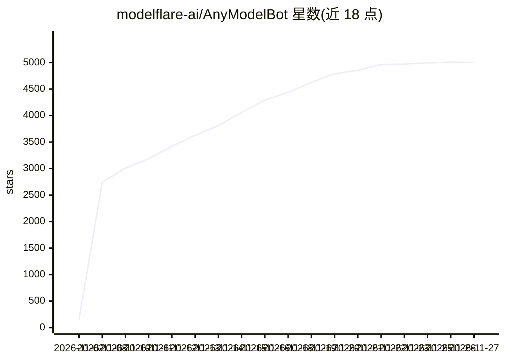

# modelflare-ai/AnyModelBot

⭐ 5,002 · Python · MIT · 推送 2026-11-26 · [GitHub](https://github.com/modelflare-ai/AnyModelBot) · [官网](https://anymodel.bot/) · 组织维护 · 中文 README

**本地优先的多模型 AI 机器人桌面应用，经微信/飞书可达**

运行在 Windows/macOS/Linux 上的 AI 机器人团队应用：每个机器人有独立人设、默认模型、工作区与记忆，可读写文件、在沙箱执行命令、经授权操作桌面，写工作区之外需审批。模型经 Modelflare 按量付费，或用官方 API Key 直连厂商；可接入微信、飞书、Telegram、Slack、Discord。支持后台任务、定时规则、预算控制、群聊与技能导入。安装包含签名与公证；源码构建需 Node.js 22.13+ 与 Go 1.26.8+。

## 筛选速览

| 维度 | 判定 | 备注 |
|---|---|---|
| AI 角色 | `ai-native` | 本体是模型或模型工具 |
| 许可风险 | `permissive` | MIT |
| 部署形态 | `desktop` | 安装包/桌面程序 |
| 模型依赖 | locked-api |  |
| 硬件要求 | — | 无带数字的原话,不猜 |
| 安装摩擦 | `low` | 无编译、无系统依赖或容器化 |
| 成熟度 | — | 结构信号不足 |

## 能力要点

- 机器人具备三档权限（只读/工作区/完全）与审批卡片机制
- 支持 OpenAI、Anthropic、Gemini、DeepSeek 等 10 家官方 API 直连或经 Modelflare 统一接入
- 后台任务、定时规则、预算与免打扰等主动消息控制
- 内置 Cua Driver 电脑操作与图片/视频生成

## 适用场景

- 在微信或飞书里随时联系自己的 AI 机器人处理任务
- 让机器人定时检查信息并在满足条件时通知我
- 让机器人在授权范围内整理本地文件、生成 PPT 和研报

## 场景标签

`AI 助手` `聊天机器人` `GUI 自动化` `视频生成` · 领域:效率与自动化

## 证据(README 行号)

> L46: AnyModelBot 是跑在 Windows / macOS / Linux 上的 AI 机器人团队。每个机器人有自己的人设、默认模型、工作区和记忆；可在应用内聊天，也可接入微信、飞书、Telegram、Slack、Discor
> L216: - **或者用自己的官方 API Key。** 支持 OpenAI、Anthropic、Google Gemini、xAI、DeepSeek、Kimi、GLM、Qwen、MiniMax 和 Mistral。Key 只存在你的设备

## 星数曲线

2026-11-02 153 → 2026-11-27 5,002（+4,849）

---
*卡片 v1 · prompt 1.4 · 生成 2026-11-27 · 置信度 high · 依据 README sha `7d180c91603a` · [字段定义](../../DATASET.md)*
