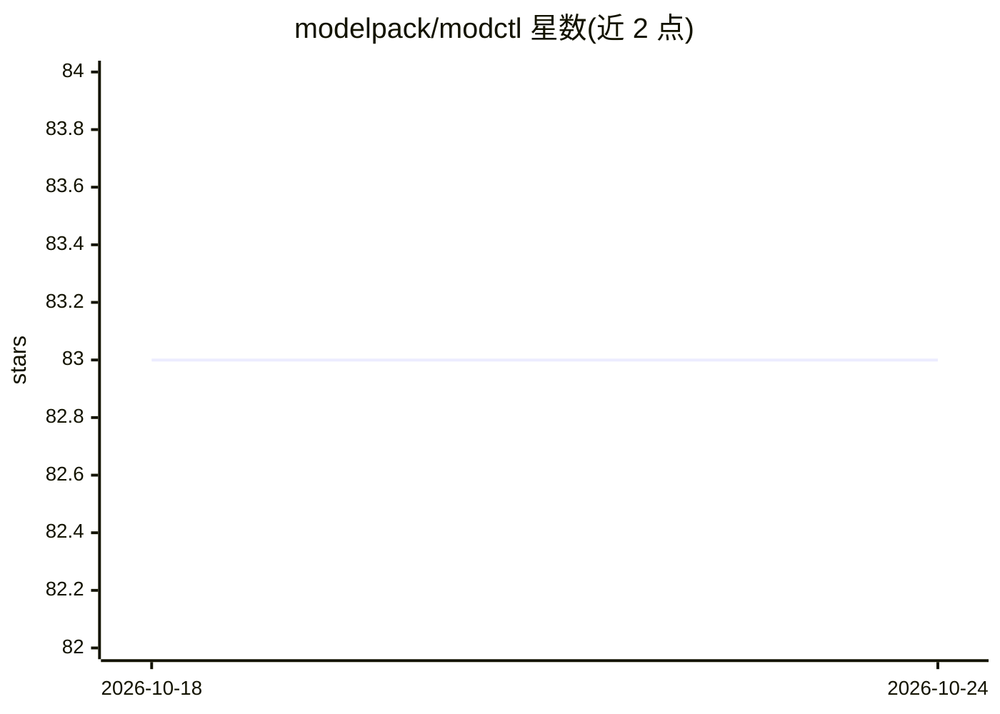

# modelpack/modctl

⭐ 83 · Go · Apache-2.0 · 推送 2026-10-23 · [GitHub](https://github.com/modelpack/modctl) · [官网](https://modelpack.github.io/modctl/) · 组织维护 · 中文 README

**管理 OCI 模型制品的命令行工具（build/pull/push）**

ModelPack 维护的 CLI 工具 modctl，将按 Model Spec 打包的 AI 模型转换为 OCI 制品，并提供 build、pull、push 等命令供用户转换与分发模型。以 Go 编写（含 GoDoc），项目网站用 Hugo 多语言构建（需 Hugo 0.167.0 与 Node.js 22+），采用 Apache 2.0 许可，属 LF Projects, LLC 旗下项目。README 未列出本 CLI 的安装命令，完整文档见项目网站。

## 筛选速览

| 维度 | 判定 | 备注 |
|---|---|---|
| AI 角色 | `ai-ecosystem` | LLM/agent 周边工具 |
| 许可风险 | `permissive` | Apache-2.0 |
| 部署形态 | `None` |  |
| 模型依赖 | — | README 未给出锁定关系 |
| 硬件要求 | — | 无带数字的原话,不猜 |
| 安装摩擦 | `low` | 无编译、无系统依赖或容器化 |
| 成熟度 | — | 结构信号不足 |

## 能力要点

- 将 AI 模型转换为 OCI 制品（基于 Model Spec 打包）
- 提供 build/pull/push 等命令管理模型制品
- 项目网站支持中英双语（Hugo 多语言）

## 适用场景

- 把训练好的模型打包为 OCI 制品以便分发
- 从/向 OCI registry 拉取与推送模型
- 以标准化 Model Spec 格式管理模型版本

## 场景标签

 · 领域:AI 模型交付/容器制品

## 证据(README 行号)

> L7: Modctl is a user-friendly CLI tool for managing OCI model artifacts, which are bundled based on Model Spec.
> L8: It offers commands such as `build`, `pull`, `push`, and more, making it easy for users to convert their AI models in

## 星数曲线

2026-10-18 83 → 2026-10-24 83（+0）

---
*卡片 v1 · prompt 1.4 · 生成 2026-10-24 · 置信度 high · 依据 README sha `d2af89fa863d` · [字段定义](../../DATASET.md)*
