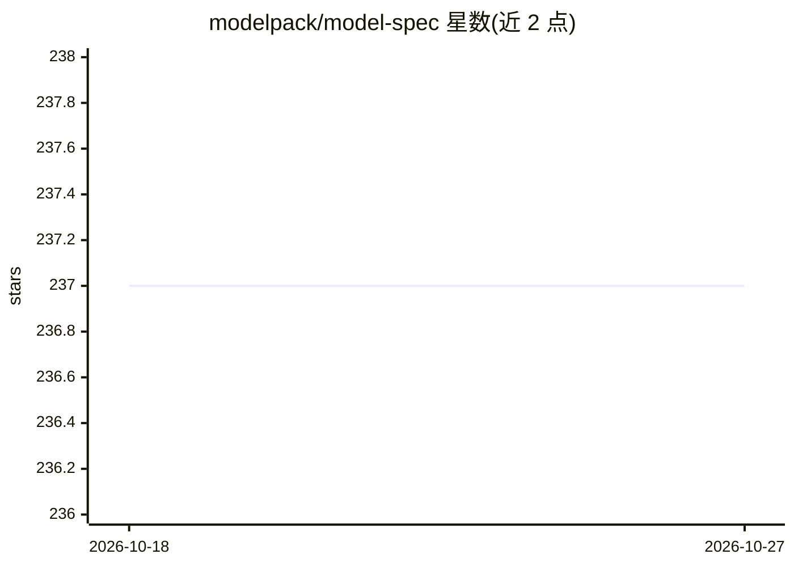

# modelpack/model-spec

⭐ 237 · Go · Apache-2.0 · 推送 2026-10-13 · [GitHub](https://github.com/modelpack/model-spec) · [官网](https://modelpack.org) · 组织维护

**CNCF 主持的 LLM 打包分发开放规范标准**

由 CNCF ModelPack 项目维护的厂商中立开源规范，定义在云原生环境中打包、分发和运行 AI 模型的标准格式。核心机制是兼容现有 OCI 镜像规范与 artifacts 指南，将模型产物作为不透明二进制处理，仅包含部分模型元数据，可在 Kubernetes 环境中作为 OCI 卷源使用。目标是让 AI/ML 产物脱离厂商专有格式，进入标准化可互换格式。以规范文档形式提供，Apache 2.0 许可，属于 LF Projects LLC 旗下。

## 筛选速览

| 维度 | 判定 | 备注 |
|---|---|---|
| AI 角色 | `ai-ecosystem` | LLM/agent 周边工具 |
| 许可风险 | `permissive` | Apache-2.0 |
| 部署形态 | `None` |  |
| 模型依赖 | — | README 未给出锁定关系 |
| 硬件要求 | — | 无带数字的原话,不猜 |
| 安装摩擦 | `low` | 无编译、无系统依赖或容器化 |
| 成熟度 | — | 结构信号不足 |

## 能力要点

- 基于 OCI 镜像规范与 artifacts 指南打包模型
- 模型产物以不透明二进制形式处理，兼容容器生态
- 可在 Kubernetes 环境中作为 OCI 卷源使用

## 适用场景

- 制定或实现符合标准的 AI 模型打包分发工具
- 将模型以容器镜像格式在云原生环境中分发
- 组织需要在 Kubernetes 中标准化引用模型产物

## 场景标签

 · 领域:云原生/AI 模型基础设施规范

## 证据(README 行号)

> L8: The Cloud Native Computing Foundation's (CNCF) ModelPack project is a vendor-neutral, open source specification stan
> L20: This specification provides a compatible way to package and distribute models based on the current OCI image specif

## 星数曲线

2026-10-18 237 → 2026-10-27 237（+0）

---
*卡片 v1 · prompt 1.4 · 生成 2026-10-22 · 置信度 high · 依据 README sha `b18c8b81733d` · [字段定义](../../DATASET.md)*
