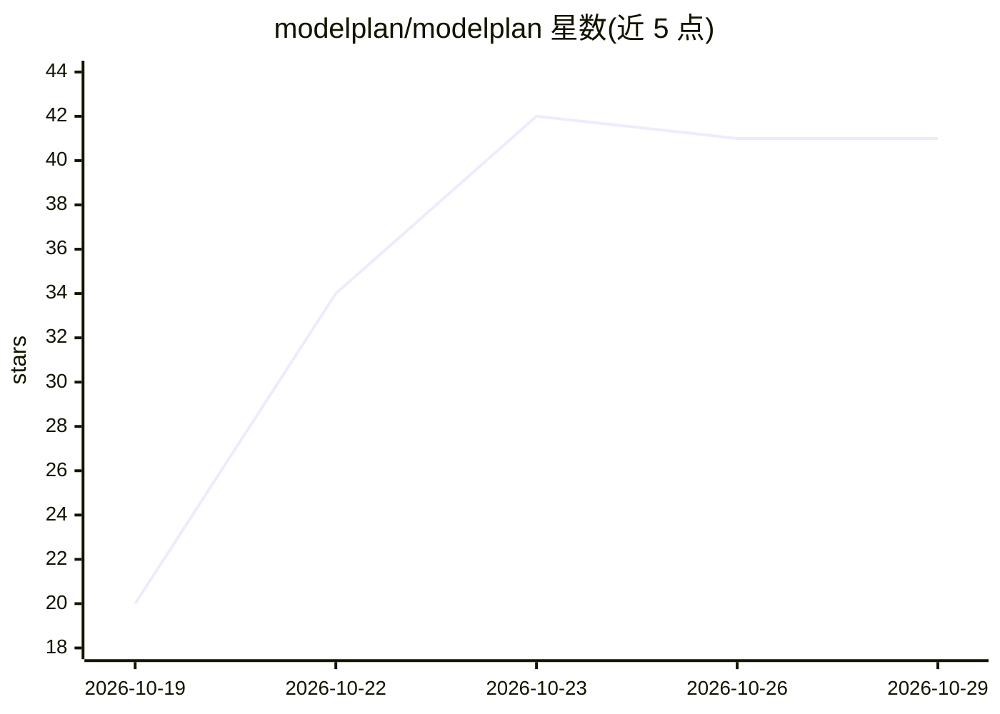

# modelplan/modelplan

⭐ 41 · Swift · MIT · 推送 2026-10-28 · [GitHub](https://github.com/modelplan/modelplan) · [官网](https://modelplan.ai) · 组织维护 · 中文 README

**AI 编码模型选型榜单与 CLI：按推荐档位比模型、结合本地配额给建议**

提供以『推荐档位（★ effort）』为基准的编码模型榜单：每个模型标注最佳性价比档位、升一档的能力增益与成本倍数、单任务成本与耗时，并指出被更优模型覆盖的型号。以网站、无密钥只读 API、Skill（适配 Claude Code、Codex、Cline 等 15+ agent）、Claude Code/Codex 插件和单二进制 CLI 提供同一份经验证的公开出版物数据。Skill 与 CLI 只读本地的 Claude Code、Codex、ZCode、OpenCode 等配额文件（不上传），据此给出升/降档建议、剩余额度提醒与套餐价格/重置日历；不代用户切换模型。

## 筛选速览

| 维度 | 判定 | 备注 |
|---|---|---|
| AI 角色 | `ai-knowledge` | 知识聚合/清单类 |
| 许可风险 | `permissive` | MIT |
| 部署形态 | `library` | 以包/库形式分发 |
| 模型依赖 | — | README 未给出锁定关系 |
| 硬件要求 | — | 无带数字的原话,不猜 |
| 安装摩擦 | `low` | 无编译、无系统依赖或容器化 |
| 成熟度 | — | 结构信号不足 |

## 能力要点

- 按每个模型的推荐档位（★）排名，展示升一档的能力增益与成本倍数
- 读取本地 Claude Code / Codex 等配额窗口，结合剩余额度给升/降档建议
- 单一数据源：每几小时重建并内容哈希校验的公开出版物，客户端不自算结论
- 单二进制 CLI + Skill + Claude Code / Codex 插件多形态交付，只读、无账号、无遥测

## 适用场景

- 在 Claude Code / Codex 中决定当前任务该用哪个模型、哪个档位
- 查看 5 小时/每周窗口剩余额度，判断升档是否划算
- 比较各厂商编码套餐的价格、配额、错峰时段与重置日历

## 场景标签

`模型评测` · 领域:评测与运维

## 证据(README 行号)

> L20: - **A leaderboard at that effort.** Models are ranked at their own ★ effort, the setup you would really use, with c
> L33: - **In your tools.** One open-source Skill for any agent, plugins for Claude Code and Codex, and a single-binary CL

## 星数曲线

2026-10-19 20 → 2026-10-29 41（+21）

---
*卡片 v1 · prompt 1.4 · 生成 2026-10-25 · 置信度 high · 依据 README sha `180b2b7f855f` · [字段定义](../../DATASET.md)*
