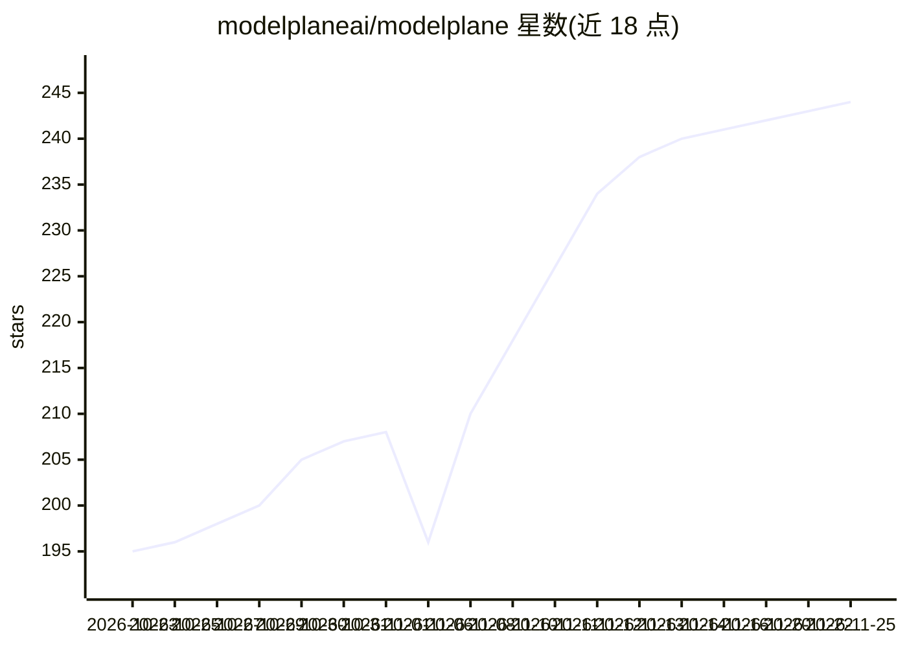

# modelplaneai/modelplane

⭐ 244 · Python · Apache-2.0 · 推送 2026-11-24 · [GitHub](https://github.com/modelplaneai/modelplane) · [官网](https://modelplane.ai) · 组织维护

**Kubernetes 上的 AI 推理控制平面：编排模型部署与服务**

基于 Crossplane 构建的推理编排系统，安装运行在用户自己的环境中，跨云、neocloud 与本地基础设施编排模型、推理服务栈与底层设施。平台团队声明 InferenceCluster/InferenceClass，开发者声明 ModelDeployment/ModelService，系统持续向声明状态调和：供给集群、按硬件调度副本、伸缩、缓存权重并路由流量。对外提供统一的 OpenAI 兼容端点，引擎不限定（任意容器化推理引擎）。当前处于 pre-1.0 早期阶段，API 可能变化。

## 筛选速览

| 维度 | 判定 | 备注 |
|---|---|---|
| AI 角色 | `ai-ecosystem` | LLM/agent 周边工具 |
| 许可风险 | `permissive` | Apache-2.0 |
| 部署形态 | `None` |  |
| 模型依赖 | — | README 未给出锁定关系 |
| 硬件要求 | — | 无带数字的原话,不猜 |
| 安装摩擦 | `low` | 无编译、无系统依赖或容器化 |
| 成熟度 | `idea` | |

## 能力要点

- 基于 Crossplane 的持续调和式控制平面
- 对开发者提供统一 OpenAI 兼容端点
- 不限定引擎，支持任意容器化推理引擎与单 GPU 到多节点拓扑
- 覆盖供给、调度、伸缩、路由（加权金丝雀/A/B）与权重缓存五类机制

## 适用场景

- 平台团队统一管理多个推理集群并发布硬件类别
- 开发者以声明式清单部署模型并获得统一端点
- 对多副本模型服务做金丝雀与 A/B 发布

## 场景标签

`推理引擎` · 领域:训练与推理

## 证据(README 行号)

> L7: Modelplane is software you install and run in your own environment to orchestrate
> L11: [Crossplane], it is an active system that continuously reconciles your fleet
> L17: declare a model and get back a unified, OpenAI-compatible endpoint. Neither team

## 星数曲线

2026-10-23 195 → 2026-11-25 244（+49）

---
*卡片 v1 · prompt 1.4 · 生成 2026-11-25 · 置信度 high · 依据 README sha `dbf3198ac3b0` · [字段定义](../../DATASET.md)*
