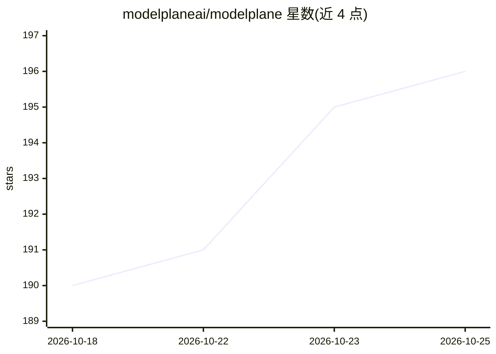

# modelplaneai/modelplane

⭐ 196 · Python · Apache-2.0 · 推送 2026-10-25 · [GitHub](https://github.com/modelplaneai/modelplane) · [官网](https://modelplane.ai) · 组织维护

**面向平台团队与开发者的 AI 推理基础设施编排控制平面**

基于 Crossplane 构建的自托管控制平面软件，运行在用户自己的环境中，跨云、neocloud 与本地设施编排模型、服务栈与底层基础设施。平台团队声明 InferenceCluster/InferenceClass 与网关，开发者声明 ModelDeployment/ModelService 即获得统一的 OpenAI 兼容端点；系统持续调和集群供给、副本调度、扩缩容、权重缓存与流量路由。对服务引擎不设限，可运行任意容器化引擎。当前为 v0.1 早期版本，API 与行为可能随版本变化。

## 筛选速览

| 维度 | 判定 | 备注 |
|---|---|---|
| AI 角色 | `ai-ecosystem` | LLM/agent 周边工具 |
| 许可风险 | `permissive` | Apache-2.0 |
| 部署形态 | `None` |  |
| 模型依赖 | — | README 未给出锁定关系 |
| 硬件要求 | — | 无带数字的原话,不猜 |
| 安装摩擦 | `low` | 无编译、无系统依赖或容器化 |
| 成熟度 | `idea` | |

## 能力要点

- 跨云/neocloud/本地编排推理集群，从单 GPU 到多节点解耦部署
- 开发者声明模型即获得 OpenAI 兼容统一端点，含加权灰度与 A/B 发布
- 持续调和五种关注点：供给、调度、扩缩、路由、权重缓存
- 引擎无关：一套 API 支持任意容器化引擎与拓扑

## 适用场景

- 平台团队统一管理 GPU 资源池并发布硬件类别
- 开发者用声明式清单部署模型并获取统一推理端点
- 多集群环境下调度与扩缩推理工作负载

## 场景标签

`推理引擎` · 领域:训练与推理

## 证据(README 行号)

> L7: Modelplane is software you install and run in your own environment to orchestrate
> L60: Modelplane runs as a control plane on its own cluster, above the inference

## 星数曲线

2026-10-18 190 → 2026-10-25 196（+6）

---
*卡片 v1 · prompt 1.4 · 生成 2026-10-22 · 置信度 high · 依据 README sha `97b3e465eee1` · [字段定义](../../DATASET.md)*
