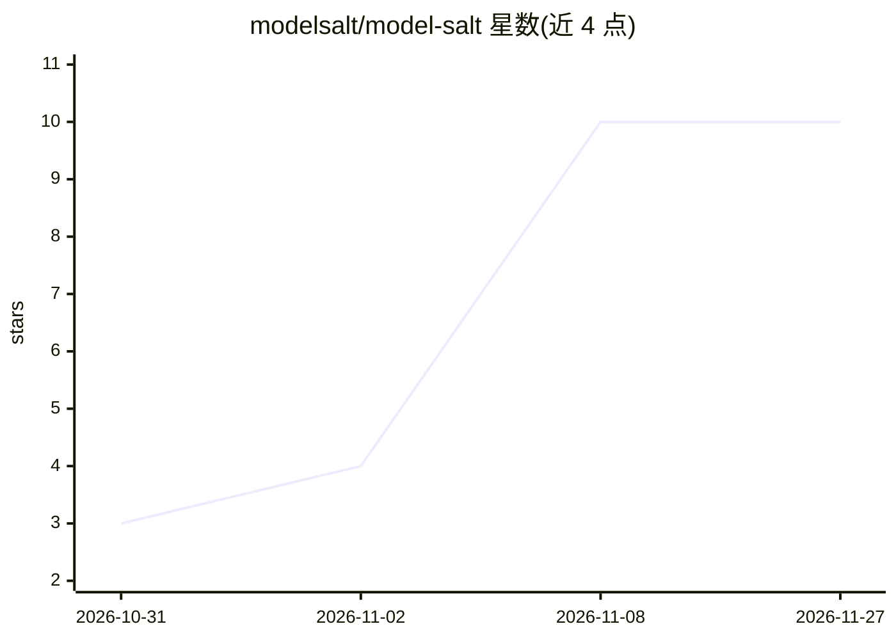

# modelsalt/model-salt

⭐ 10 · JavaScript · MIT · 推送 2026-11-23 · [GitHub](https://github.com/modelsalt/model-salt) · [官网](https://modelsalt.com) · 个人维护

**给 MCP 客户端注入外部随机性的服务器：同一提示产生不同结果**

Model Salt 是一个 MCP 服务器，安装后在 Claude Code、Codex、Gemini CLI、Kimi Code 中注册 model_salt 工具。工作流程：先用一次短运行让模型列出请求中的开放决策点及候选答案，再从外部公共随机源（LfD 量子随机数、drand、NIST beacon）取随机字节为每个决策点选定答案，模型随后按已确定的答案执行请求；支持 0-2 的随机度设置与 keep 字段保留已选定项。依赖 Node 18+，盐化回答耗时与 token 消耗高于普通提示，单一正确答案的问题会跳过该工具。

## 筛选速览

| 维度 | 判定 | 备注 |
|---|---|---|
| AI 角色 | `ai-ecosystem` | LLM/agent 周边工具 |
| 许可风险 | `permissive` | MIT |
| 部署形态 | `library` | 以包/库形式分发 |
| 模型依赖 | — | README 未给出锁定关系 |
| 硬件要求 | — | 无带数字的原话,不猜 |
| 安装摩擦 | `low` | 无编译、无系统依赖或容器化 |
| 成熟度 | — | 结构信号不足 |

## 能力要点

- 通过 MCP 工具将模型外部随机源（量子噪声/drand/NIST beacon）接入提示流程
- 0-2 档随机度控制，0.5 档约 70% 保持模型常规选择
- keep 字段可保留部分已选定决策，仅重掷开放选项
- 提供 npx setup 一键安装与 uninstall 撤销，支持 --dry-run 预览

## 适用场景

- 生成 SVG/图片/页面时希望多次运行产出不同结果
- 起名、写故事开头等创意任务避免重复答案
- 在 Claude Code/Codex/Gemini CLI/Kimi Code 中以插件形式添加该工具

## 场景标签

 · 领域:LLM 工具/MCP 生态

## 证据(README 行号)

> L3: Ask a language model for the same thing ten times and you get the same answer ten times. Model Salt is an MCP server
> L101: - **By hand:** add a stdio MCP server that runs `npx -y @modelsalt/model-salt anthropic` (Claude, Gemini and Kimi 

## 星数曲线

2026-10-31 3 → 2026-11-27 10（+7）

---
*卡片 v1 · prompt 1.4 · 生成 2026-11-19 · 置信度 mid · 依据 README sha `a0ec38076512` · [字段定义](../../DATASET.md)*
