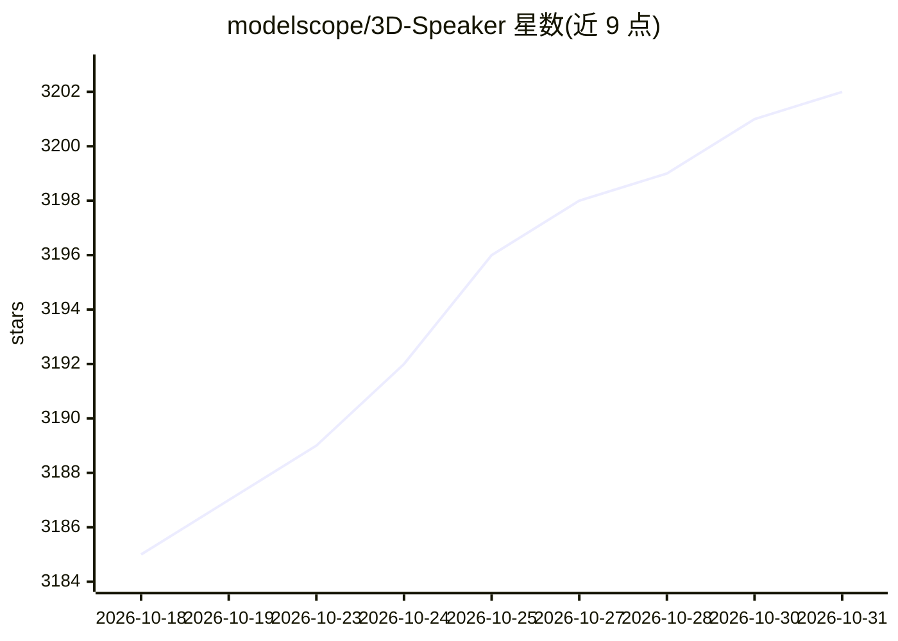

# modelscope/3D-Speaker

⭐ 3,202 · Python · Apache-2.0 · 推送 2025-12-08 · [GitHub](https://github.com/modelscope/3D-Speaker) · 组织维护 · 中文 README

**开源说话人验证/识别/分离工具包，附大规模语音数据集**

ModelScope 团队维护的单模态与多模态说话人研究工具包：提供说话人验证（CAM++、ERes2Net、ECAPA-TDNN、ResNet 等）、自监督验证（RDINO、SDPN）、说话人分离、语种识别的训练与推理配方，预训练模型发布于 ModelScope，另提供 ONNX Runtime 推理脚本。配套 3D-Speaker 大规模语音数据集用于语音表征解耦研究。通过 git clone 加 conda/pip 环境从源码运行，各实验以 egs/ 目录下脚本组织。

## 筛选速览

| 维度 | 判定 | 备注 |
|---|---|---|
| AI 角色 | `ai-native` | 本体是模型或模型工具 |
| 许可风险 | `permissive` | Apache-2.0 |
| 部署形态 | `library` | 以包/库形式分发 |
| 模型依赖 | — | README 未给出锁定关系 |
| 硬件要求 | — | 无带数字的原话,不猜 |
| 安装摩擦 | `low` | 无编译、无系统依赖或容器化 |
| 成熟度 | — | 结构信号不足 |

## 能力要点

- 覆盖监督/自监督说话人验证、分离、语种识别的训练与推理配方
- 多说话人分离含重叠检测、VAD、分割、嵌入提取与聚类等模块
- 预训练模型发布于 ModelScope，含 ONNX Runtime 推理脚本
- 配套 3D-Speaker 数据集与多数据集（VoxCeleb/CN-Celeb）基准

## 适用场景

- 训练或微调说话人验证/识别模型
- 用预训练模型做说话人分离与语种识别推理
- 基于 3D-Speaker 数据集做语音表征研究

## 场景标签

`语音识别` `微调` · 领域:感知与多模态

## 证据(README 行号)

> L6:  3D-Speaker is an open-source toolkit for single- and multi-modal speaker verification, speaker recognition, and spe
> L47: ### Inference using pretrained models from Modelscope

## 星数曲线

2026-10-18 3,185 → 2026-10-31 3,202（+17）

---
*卡片 v1 · prompt 1.4 · 生成 2026-10-21 · 置信度 mid · 依据 README sha `47f49656f408` · [字段定义](../../DATASET.md)*
