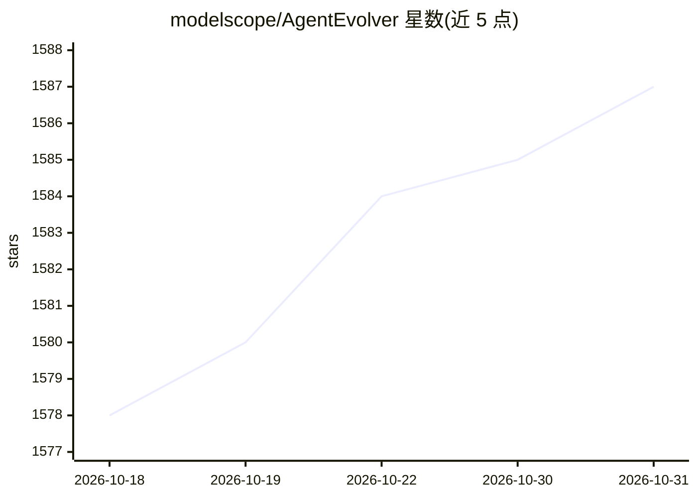

# modelscope/AgentEvolver

⭐ 1,587 · Python · Apache-2.0 · 推送 2026-04-01 · [GitHub](https://github.com/modelscope/AgentEvolver) · [官网](https://modelscope.github.io/AgentEvolver/) · 组织维护

**自进化 LLM Agent 的端到端强化学习训练框架**

面向 LLM Agent 的自进化训练框架，统一三种机制：Self-Questioning（自动探索环境生成任务）、Self-Navigating（跨任务经验复用引导 rollout）、Self-Attributing（基于因果归因的细粒度信用分配，ADCA-GRPO）。采用服务化数据流架构，集成环境沙箱、LLM 与经验管理为模块服务，支持 GRPO 等 RL 训练与 AppWorld、BFCL-v3 等环境；另扩展出多智能体社交博弈训练竞技场（Avalon/Diplomacy）。需 conda 与 CUDA 工具链，通过 install.sh 与示例脚本运行。

## 筛选速览

| 维度 | 判定 | 备注 |
|---|---|---|
| AI 角色 | `ai-ecosystem` | LLM/agent 周边工具 |
| 许可风险 | `permissive` | Apache-2.0 |
| 部署形态 | `None` |  |
| 模型依赖 | — | README 未给出锁定关系 |
| 硬件要求 | — | 无带数字的原话,不猜 |
| 安装摩擦 | `medium` | 含编译或系统依赖之一 |
| 成熟度 | — | 结构信号不足 |

## 能力要点

- 自动任务生成、经验引导探索、归因式信用分配三种自进化机制
- 服务化数据流架构，环境沙箱/LLM/经验管理解耦为模块服务
- Game Arena：Avalon/Diplomacy 等社交博弈中的交互、评测与 GRPO 训练
- 支持 ADCA-GRPO 细粒度优势处理与 ReMe 经验池（可选）

## 适用场景

- 在 AppWorld 等环境中用 RL 训练自进化 LLM Agent
- 避免人工标注，自动生成任务构建训练数据
- 在多智能体社交博弈中做自博弈评测与训练

## 场景标签

`强化学习` `多智能体` · 领域:Agent 开发

## 证据(README 行号)

> L12: **AgentEvolver** is an end-to-end, self-evolving training framework that unifies self-questioning, self-navigating,
> L25: 🧠 AgentEvolver provides three **Self-Evolving Mechanisms** from Environment to Policy:
> L133: - `bash examples/run_basic.sh` - Execute basic RL pipeline with GRPO using built-in datasets within environments.

## 星数曲线

2026-10-18 1,578 → 2026-10-31 1,587（+9）

---
*卡片 v1 · prompt 1.4 · 生成 2026-10-21 · 置信度 high · 依据 README sha `48368287cfbd` · [字段定义](../../DATASET.md)*
