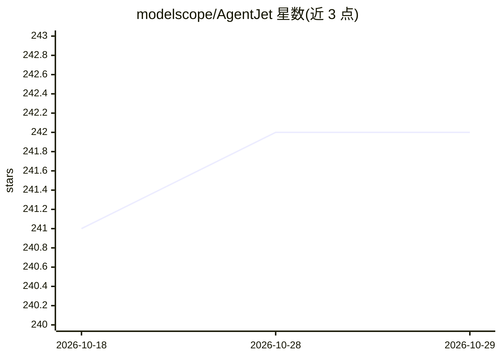

# modelscope/AgentJet

⭐ 242 · Python · Apache-2.0 · 推送 2026-08-25 · [GitHub](https://github.com/modelscope/AgentJet) · [官网](https://modelscope.github.io/AgentJet/) · 组织维护 · 中文 README

**面向 LLM agent 的强化学习微调训练框架，支持分布式 Swarm 训练**

AgentJet 是一个 agent RL 训练框架：用户提交可训练工作流（继承 Workflow 类，支持 OpenAI SDK/AgentScope/LangChain/原生 HTTP 构建的 agent）、任务数据源与奖励函数，框架微调 LLM 权重。默认以 verl 为训练后端，另支持 trinity 与 debug 后端。提供 Swarm 分布式模式，可在 GPU 服务器部署 swarm server、从无 GPU 的笔记本远程发起训练；含上下文合并加速多轮/多 agent 训练、token 级日志与多 agent 非共享参数训练。给 agent 开发者与研究人员使用。

## 筛选速览

| 维度 | 判定 | 备注 |
|---|---|---|
| AI 角色 | `ai-ecosystem` | LLM/agent 周边工具 |
| 许可风险 | `permissive` | Apache-2.0 |
| 部署形态 | `None` |  |
| 模型依赖 | — | README 未给出锁定关系 |
| 硬件要求 | — | 无带数字的原话,不猜 |
| 安装摩擦 | `low` | 无编译、无系统依赖或容器化 |
| 成熟度 | `idea` | |

## 能力要点

- Swarm 分布式训练：GPU 服务器部署 swarm server，笔记本远程发起训练
- 支持任意 OpenAI SDK/AgentScope/LangChain/HTTP 构建的 agent
- 上下文合并技术，多轮/多 agent 训练加速 1.5x-10x
- verl 默认后端，另支持 trinity 异步 RFT 与 debug 断点调试后端

## 适用场景

- 对我用 AgentScope 或 LangChain 写的 agent 做 RL 微调
- 在 GPU 集群上远程进行多 agent 分布式训练
- 通过 token 级日志诊断 agent 工作流训练过程

## 场景标签

`微调` `强化学习` · 领域:训练与推理

## 证据(README 行号)

> L12: **AgentJet (AJet)** is a cutting-edge, user-friendly agent RL training framework designed to optimize agents and ag
> L14: **AgentJet (AJet)** has fully-distributed **swarm training** capability, which means that you can **deploy `ajet-sw
> L64: - **Efficient and Scalable**. AgentJet uses [verl] as the default backbone (`--backbone=verl`). However, we also su

## 星数曲线

2026-10-18 241 → 2026-10-29 242（+1）

---
*卡片 v1 · prompt 1.4 · 生成 2026-10-22 · 置信度 high · 依据 README sha `8c329271b326` · [字段定义](../../DATASET.md)*
