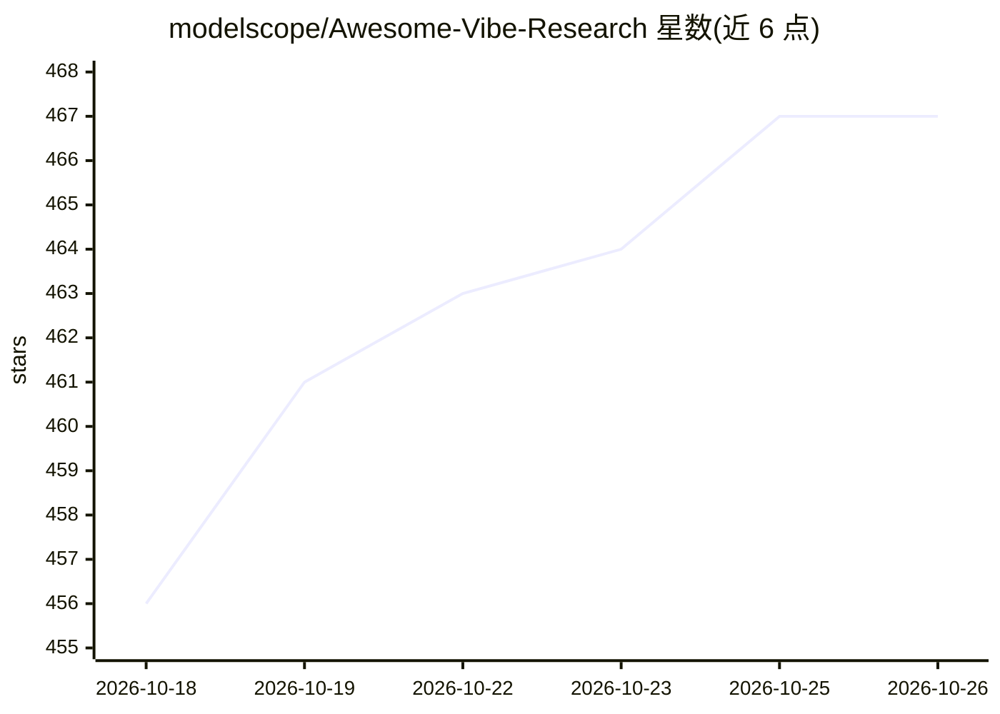

# modelscope/Awesome-Vibe-Research

⭐ 467 · Python · Apache-2.0 · 推送 2026-10-25 · [GitHub](https://github.com/modelscope/Awesome-Vibe-Research) · 组织维护 · 中文 README

**AI 辅助科研全流程的 agents/skills/workflow 策展清单**

由 ModelScope 维护的开放共建清单：按科研生命周期 10 个阶段（方向扫描、文献研究、数据制备、方法设计、实验执行、可视化、论文写作、复现发布、传播等）组织条目，收录 agent、skill、workflow、工具与最佳实践，条目含 Stars（GitHub Action 每日自动更新）、链接、Demo 与论文信息。收录标准要求面向科研场景、有可运行代码、近 6 个月仍在维护。贡献方式为在对应表格加行，建议发布在魔搭研习社。

## 筛选速览

| 维度 | 判定 | 备注 |
|---|---|---|
| AI 角色 | `ai-knowledge` | 知识聚合/清单类 |
| 许可风险 | `permissive` | Apache-2.0 |
| 部署形态 | `None` |  |
| 模型依赖 | — | README 未给出锁定关系 |
| 硬件要求 | — | 无带数字的原话,不猜 |
| 安装摩擦 | `low` | 无编译、无系统依赖或容器化 |
| 成熟度 | — | 结构信号不足 |

## 能力要点

- 科研 10 阶段流程地图组织全部条目
- 条目类型覆盖 agent、skill、workflow、tool 与最佳实践
- Stars 数由 GitHub Action 自动维护
- 明确收录标准（科研场景、可运行、近 6 个月有维护、文档清晰）

## 适用场景

- 按科研阶段查找可复用的 AI agent 或 skill
- 了解端到端自动科研系统的项目分布
- 沉淀并分享自己在科研中跑通的 AI 辅助流程

## 场景标签

`科研工具` `精选清单` · 领域:学习与行业

## 证据(README 行号)

> L5:  面向 AI 辅助科研的开放共建仓库
> L28: 下表是我们对科研生命周期的 **10 阶段**拆分。每个阶段列出了"典型问题"和"可沉淀的 AI 辅助组件类型"。正文按阶段展开条目表，收录已知最好的项目、skill、workflow。
> L49: |项目名称|描述|类型|Stars|链接|Demo|Paper|

## 星数曲线

2026-10-18 456 → 2026-10-26 467（+11）

---
*卡片 v1 · prompt 1.4 · 生成 2026-10-21 · 置信度 high · 依据 README sha `1e7dac91ff9c` · [字段定义](../../DATASET.md)*
