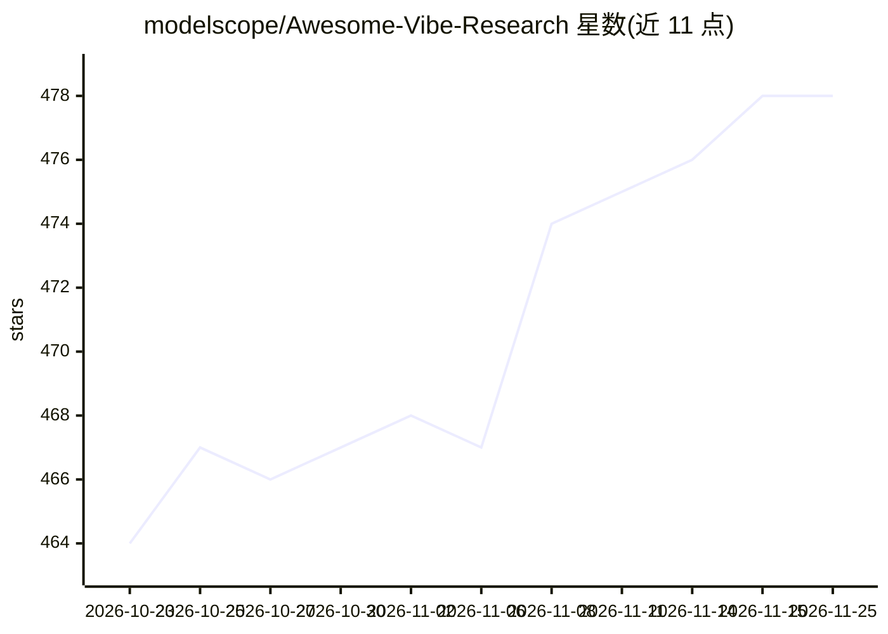

# modelscope/Awesome-Vibe-Research

⭐ 478 · Python · Apache-2.0 · 推送 2026-11-11 · [GitHub](https://github.com/modelscope/Awesome-Vibe-Research) · 组织维护 · 中文 README

**面向 AI 辅助科研的开放共建资源清单仓库**

由 ModelScope 组织维护的策展型仓库，按科研生命周期 10 个阶段（方向扫描、文献研究、数据制备、方法设计、实验执行、可视化、写作、复现发布、传播）组织条目表，收录 agent、skill、workflow、tool 与平台资源，附 Star 数自动更新机制与收录原则。内容源自「与 Agent 共事做研究」系列沙龙的实践经验沉淀，社区通过在表格中添加行的方式贡献。

## 筛选速览

| 维度 | 判定 | 备注 |
|---|---|---|
| AI 角色 | `ai-knowledge` | 知识聚合/清单类 |
| 许可风险 | `permissive` | Apache-2.0 |
| 部署形态 | `None` |  |
| 模型依赖 | — | README 未给出锁定关系 |
| 硬件要求 | — | 无带数字的原话,不猜 |
| 安装摩擦 | `low` | 无编译、无系统依赖或容器化 |
| 成熟度 | — | 结构信号不足 |

## 能力要点

- 按科研生命周期 10 阶段组织的条目表（agent/skill/workflow/tool 分类）
- Stars 列由 GitHub Action 每日自动更新
- 收录原则要求项目 6 个月内有更新且有可运行代码
- 提供中英双语版本与最佳实践教程专栏

## 适用场景

- 为科研课题查找端到端自动科研或文献综述类 agent
- 寻找论文写作、引用核验、可视化等阶段的专用 skill
- 了解 AI 辅助科研工具生态的分布并向社区推荐项目

## 场景标签

`精选清单` `科研工具` `教程课程` · 领域:学习与行业

## 证据(README 行号)

> L5:  面向 AI 辅助科研的开放共建仓库
> L6:  收集和沉淀科研全流程中的 agents、skills、workflows、tools 与最佳实践
> L28: 下表是我们对科研生命周期的 **10 阶段**拆分。每个阶段列出了"典型问题"和"可沉淀的 AI 辅助组件类型"。正文按阶段展开条目表，收录已知最好的项目、skill、workflow。

## 星数曲线

2026-10-23 464 → 2026-11-25 478（+14）

---
*卡片 v1 · prompt 1.4 · 生成 2026-11-25 · 置信度 high · 依据 README sha `15e36b266383` · [字段定义](../../DATASET.md)*
