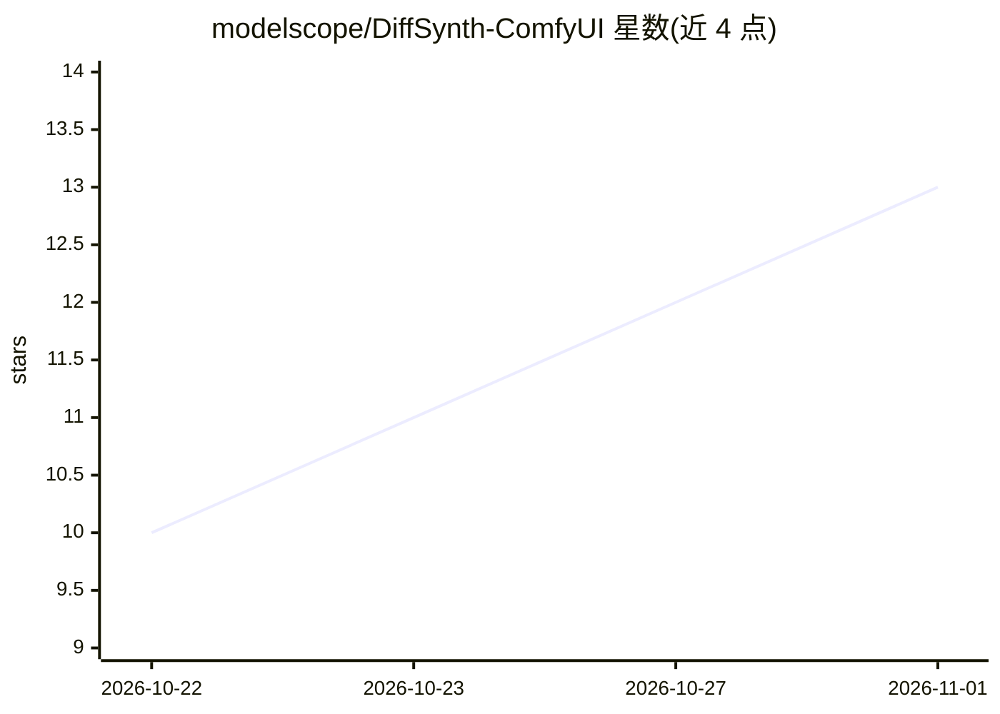

# modelscope/DiffSynth-ComfyUI

⭐ 13 · Python · Apache-2.0 · 推送 2026-10-22 · [GitHub](https://github.com/modelscope/DiffSynth-ComfyUI) · 组织维护 · 中文 README

**将 DiffSynth-Studio 生成能力接入 ComfyUI 的自定义节点插件**

ModelScope 维护的 ComfyUI 自定义节点插件：把 DiffSynth-Studio 的模型配置、量化、LoRA 加载与推理管线能力封装为节点，用户在 ComfyUI 中以节点连线方式完成图像、视频与音频的生成和编辑。节点分 4 类：模型与显存管理（四级显存策略、VRAM 限制、bitsandbytes 量化）、管线加载器、推理节点与 LoRA 链式加载。依赖已安装的 ComfyUI 与 DiffSynth-Studio，示例以 Qwen-Image 文生图演示。

## 筛选速览

| 维度 | 判定 | 备注 |
|---|---|---|
| AI 角色 | `ai-native` | 本体是模型或模型工具 |
| 许可风险 | `permissive` | Apache-2.0 |
| 部署形态 | `library` | 以包/库形式分发 |
| 模型依赖 | — | README 未给出锁定关系 |
| 硬件要求 | — | 无带数字的原话,不猜 |
| 安装摩擦 | `low` | 无编译、无系统依赖或容器化 |
| 成熟度 | — | 结构信号不足 |

## 能力要点

- 四级显存管理策略（offload/onload/preparing/computation）与 VRAM 限制节点
- 量化配置节点支持 bitsandbytes NF4/FP4，可分模块混合量化
- LoRA Clear/Load 链式节点支持多 LoRA 叠加
- 提供模板工作流与从零搭建的节点连线示例

## 适用场景

- 在 ComfyUI 中用节点方式跑 DiffSynth-Studio 的图像/视频/音频生成管线
- 低显存环境下通过显存策略与量化跑扩散模型
- 为生成管线叠加多个 LoRA 权重

## 场景标签

`图像生成` `视频生成` · 领域:内容生成

## 证据(README 行号)

> L3: A ComfyUI custom node plugin for the open-source framework DiffSynth-Studio. It integrates DiffSynth-Studio's model 
> L68: #### Example: Qwen-Image Text-to-Image

## 星数曲线

2026-10-22 10 → 2026-11-01 13（+3）

---
*卡片 v1 · prompt 1.4 · 生成 2026-10-31 · 置信度 mid · 依据 README sha `cfaf5a97d1bb` · [字段定义](../../DATASET.md)*
