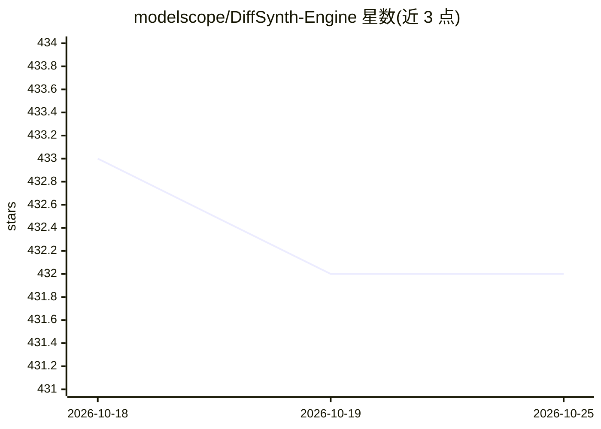

# modelscope/DiffSynth-Engine

⭐ 432 · Python · Apache-2.0 · 推送 2026-09-03 · [GitHub](https://github.com/modelscope/DiffSynth-Engine) · 组织维护 · 中文 README

**扩散模型高性能推理引擎：构建文生图/文生视频流水线**

面向开发者的 diffusion 模型推理引擎，自行重实现采样器、调度器等流水线组件，不依赖 k-diffusion/ldm/sgm 等库。支持 CivitAI 等主流格式的基础模型与 LoRA，覆盖 Flux.1、Qwen-Image、Qwen-Image-Edit、Wan2.2 系列图像与视频生成模型。提供 FP8/INT8 量化与卸载策略，可在有限 GPU 显存下加载较大模型；可运行于 Windows、macOS（Apple Silicon）与 Linux。以 pip 包与源码两种方式安装，需 Python 3.10+ 与 NVIDIA 算力 8.6+ GPU 或 Apple Silicon M 系列。

## 筛选速览

| 维度 | 判定 | 备注 |
|---|---|---|
| AI 角色 | `ai-native` | 本体是模型或模型工具 |
| 许可风险 | `permissive` | Apache-2.0 |
| 部署形态 | `library` | 以包/库形式分发 |
| 模型依赖 | — | README 未给出锁定关系 |
| 硬件要求 | — | 无带数字的原话,不猜 |
| 安装摩擦 | `low` | 无编译、无系统依赖或容器化 |
| 成熟度 | — | 结构信号不足 |

## 能力要点

- 自研重实现采样器/调度器等组件，不依赖 k-diffusion、ldm、sgm
- 支持 FP8/INT8 量化与卸载策略，有限显存加载 Flux.1 级别模型
- 支持 LoRA 与 CivitAI 等主流模型格式
- 跨平台运行：Windows、macOS（Apple Silicon）、Linux

## 适用场景

- 在本地或服务端搭建文生图、文生视频推理流水线
- 加载 Flux、Qwen-Image、Wan2.2 等模型并叠加 LoRA 做定制生成
- 在显存有限的 GPU 上通过量化加载大参数量扩散模型

## 场景标签

`推理引擎` `图像生成` `视频生成` `模型量化` · 领域:内容生成

## 证据(README 行号)

> L9: DiffSynth-Engine is a high-performance engine geared towards building efficient inference pipelines for diffusion mo
> L20: - **Optimized Performance:** Carefully-crafted inference pipeline to achieve fast generation across various hardwar

## 星数曲线

2026-10-18 433 → 2026-10-25 432（-1）

---
*卡片 v1 · prompt 1.4 · 生成 2026-10-21 · 置信度 high · 依据 README sha `b736de334826` · [字段定义](../../DATASET.md)*
