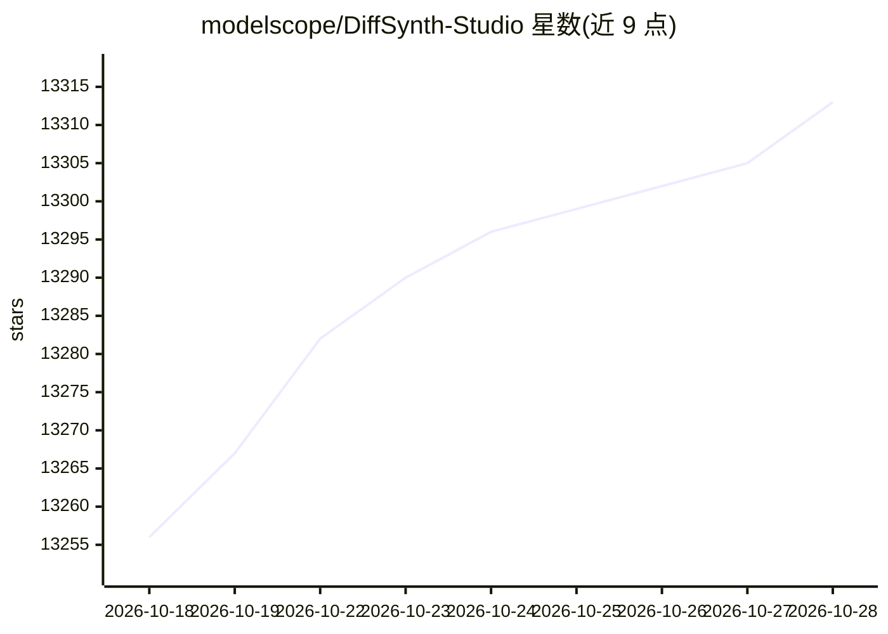

# modelscope/DiffSynth-Studio

⭐ 13,318 · Python · Apache-2.0 · 推送 2026-10-27 · [GitHub](https://github.com/modelscope/DiffSynth-Studio) · 组织维护 · 中文 README

**开源 Diffusion 模型引擎：统一推理与训练图像/视频/音频生成模型**

由 ModelScope 社区团队维护的 Diffusion 模型引擎，集成主流开源扩散模型的推理与训练，覆盖文生图、图像编辑、视频生成、音乐生成及图像质量指标模型。关键机制包括：跨磁盘/内存/显存动态调度模型参数以支持低显存消费级 GPU 运行大模型、NF4/INT8/EntroPack 等参数量化、几乎所有可推理模型均可训练（Base/LoRA/Adapter）、CPU Offload 训练与计算图拆分的两阶段训练。以 PyPI 包与源码方式安装，配套 ComfyUI 节点包与 WebUI 训练工具。限制：大版本更新后部分旧功能不再维护。

## 筛选速览

| 维度 | 判定 | 备注 |
|---|---|---|
| AI 角色 | `ai-ecosystem` | LLM/agent 周边工具 |
| 许可风险 | `permissive` | Apache-2.0 |
| 部署形态 | `library` | 以包/库形式分发 |
| 模型依赖 | — | README 未给出锁定关系 |
| 硬件要求 | — | 无带数字的原话,不猜 |
| 安装摩擦 | `low` | 无编译、无系统依赖或容器化 |
| 成熟度 | — | 结构信号不足 |

## 动量与使用信号

- 维护:`active` — 距上次 push 1.9 天,年发版 1,69 位贡献者
- 涨星:近 1 天 **+3**(自 20261016 起算)
- 平台:WEB · 协议:—

## 能力要点

- 集成图像/视频/音频生成与图像质量指标等主流扩散模型
- 磁盘-内存-显存动态调度，低显存消费级 GPU 可运行大模型推理
- NF4/INT8/EntroPack 多种量化后端与量化+LoRA 训练
- 几乎全部可推理模型均支持训练（Base/LoRA/Adapter），含 CPU Offload 训练

## 适用场景

- 在低显存 GPU 上运行和微调大参数扩散模型
- 统一框架内做多种开源图像/视频/音频模型的推理与 LoRA 训练
- 通过量化与显存管理降低大模型推理和训练成本

## 场景标签

`图像生成` `视频生成` `微调` `推理引擎` · 领域:内容生成

## 证据(README 行号)

> L16: Welcome to the magical world of Diffusion models! DiffSynth-Studio is an open-source Diffusion model engine develop
> L20: * Model Support: The framework integrates mainstream open-source Diffusion models, covering image generation, video
> L21: * VRAM Management: Dynamically schedules model parameters across disk, memory, and VRAM, allowing consumer-grade GP

## 星数曲线

2026-10-18 13,256 → 2026-10-28 13,313（+57）

---
*卡片 v1 · prompt 1.4 · 生成 2026-10-20 · 置信度 high · 依据 README sha `a790bfcba924` · [字段定义](../../DATASET.md)*
