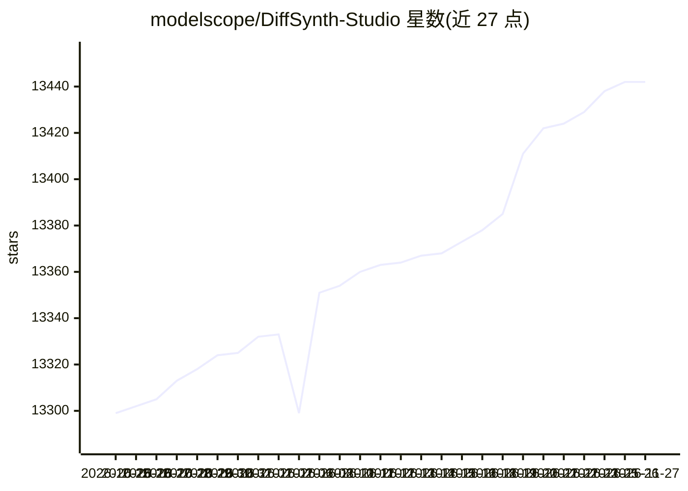

# modelscope/DiffSynth-Studio

⭐ 13,442 · Python · Apache-2.0 · 推送 2026-11-26 · [GitHub](https://github.com/modelscope/DiffSynth-Studio) · 组织维护 · 中文 README

**开源 Diffusion 模型引擎：低显存运行图像/视频/音频生成与训练**

由 ModelScope 社区团队开发维护的 Diffusion 模型引擎，集成主流开源扩散模型，覆盖图像生成、视频生成、音频生成与图像质量评估。核心机制包括跨磁盘/内存/显存的动态参数调度、NF4/INT8 等量化以降低消费级 GPU 的推理与 LoRA 训练门槛，以及对推理模型的对应训练支持。声明主要维护者为两名开发者，新功能进展与 issue 响应速度有限；大版本更新后部分旧功能不再维护。

## 筛选速览

| 维度 | 判定 | 备注 |
|---|---|---|
| AI 角色 | `ai-native` | 本体是模型或模型工具 |
| 许可风险 | `permissive` | Apache-2.0 |
| 部署形态 | `library` | 以包/库形式分发 |
| 模型依赖 | — | README 未给出锁定关系 |
| 硬件要求 | — | 无带数字的原话,不猜 |
| 安装摩擦 | `low` | 无编译、无系统依赖或容器化 |
| 成熟度 | — | 结构信号不足 |

## 动量与使用信号

- 维护:`active` — 距上次 push 1.9 天,年发版 1,69 位贡献者
- 涨星:近 1 天 **+3**(自 20261016 起算)
- 平台:WEB · 协议:—

## 能力要点

- 集成图像、视频、音频生成及图像质量评估类开源扩散模型
- 显存管理：参数在磁盘/内存/显存间动态调度，低显存消费级 GPU 可推理大模型
- NF4/INT8 等量化与 LoRA 训练支持
- 多 GPU 并行推理与 KV-Cache 压缩模块（EntroPack/SVD/Cholesky-QR）

## 适用场景

- 在消费级低显存 GPU 上运行大型扩散模型推理
- 为图像/视频生成模型做 LoRA 或全量训练
- 为生成模型做参数量化以降低部署门槛

## 场景标签

`图像生成` `视频生成` `微调` `模型量化` · 领域:内容生成

## 证据(README 行号)

> L16: Welcome to the magical world of Diffusion models! DiffSynth-Studio is an open-source Diffusion model engine develop
> L20: * Model Support: The framework integrates mainstream open-source Diffusion models, covering image generation, video
> L21: * VRAM Management: Dynamically schedules model parameters across disk, memory, and VRAM, allowing consumer-grade GP

## 星数曲线

2026-10-25 13,299 → 2026-11-27 13,442（+143）

---
*卡片 v1 · prompt 1.4 · 生成 2026-11-26 · 置信度 high · 依据 README sha `64e607a475b2` · [字段定义](../../DATASET.md)*
