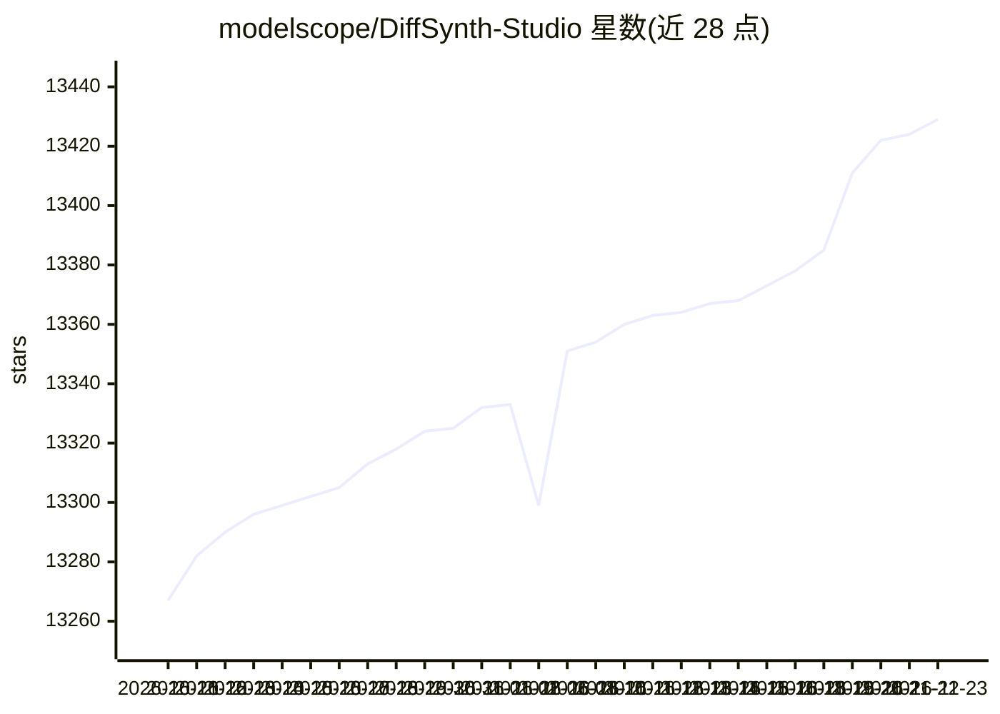

# modelscope/DiffSynth-Studio

⭐ 13,429 · Python · Apache-2.0 · 推送 2026-11-22 · [GitHub](https://github.com/modelscope/DiffSynth-Studio) · 组织维护 · 中文 README

**开源 Diffusion 模型引擎：图像/视频/音频生成与训练**

由 ModelScope 社区团队开发维护的 Diffusion 模型引擎，集成图像生成、视频生成、音频生成与画质评估模型。核心机制包括跨磁盘/内存/显存的参数动态调度、NF4/INT8 等量化以降低显存需求，以及覆盖基模型、LoRA 与 Adapter 的训练支持，并提供分阶段训练。围绕它还有 ComfyUI 节点包、LoRA 训练 WebUI 和推理服务代码。README 声明开发人力有限，新功能进展与 issue 响应速度受限。

## 筛选速览

| 维度 | 判定 | 备注 |
|---|---|---|
| AI 角色 | `ai-native` | 本体是模型或模型工具 |
| 许可风险 | `permissive` | Apache-2.0 |
| 部署形态 | `library` | 以包/库形式分发 |
| 模型依赖 | — | README 未给出锁定关系 |
| 硬件要求 | — | 无带数字的原话,不猜 |
| 安装摩擦 | `low` | 无编译、无系统依赖或容器化 |
| 成熟度 | — | 结构信号不足 |

## 动量与使用信号

- 维护:`active` — 距上次 push 1.9 天,年发版 1,69 位贡献者
- 涨星:近 1 天 **+3**(自 20261016 起算)
- 平台:WEB · 协议:—

## 能力要点

- 集成主流开源 Diffusion 模型：图像、视频、音频生成与画质评估
- 显存管理：参数在磁盘/内存/显存间动态调度，低显存消费级 GPU 可跑大模型
- 量化支持 NF4/INT8 等，含 EntroPack 量化后端（最低 3-bit）
- 支持推理的模型几乎都支持训练（基模型/LoRA/Adapter）

## 适用场景

- 在低显存消费级 GPU 上运行大参数量扩散模型推理
- 为图像/视频/音频模型做 LoRA 或全量训练
- 通过 ComfyUI 节点搭建生成工作流
- 基于单卡 H20 集群部署图像/视频/音频模型推理服务

## 场景标签

`图像生成` `视频生成` `微调` `模型量化` · 领域:内容生成

## 证据(README 行号)

> L16: Welcome to the magical world of Diffusion models! DiffSynth-Studio is an open-source Diffusion model engine develop
> L20: * Model Support: The framework integrates mainstream open-source Diffusion models, covering image generation, video

## 星数曲线

2026-10-21 13,267 → 2026-11-23 13,429（+162）

---
*卡片 v1 · prompt 1.4 · 生成 2026-11-22 · 置信度 high · 依据 README sha `865af9ac07f1` · [字段定义](../../DATASET.md)*
