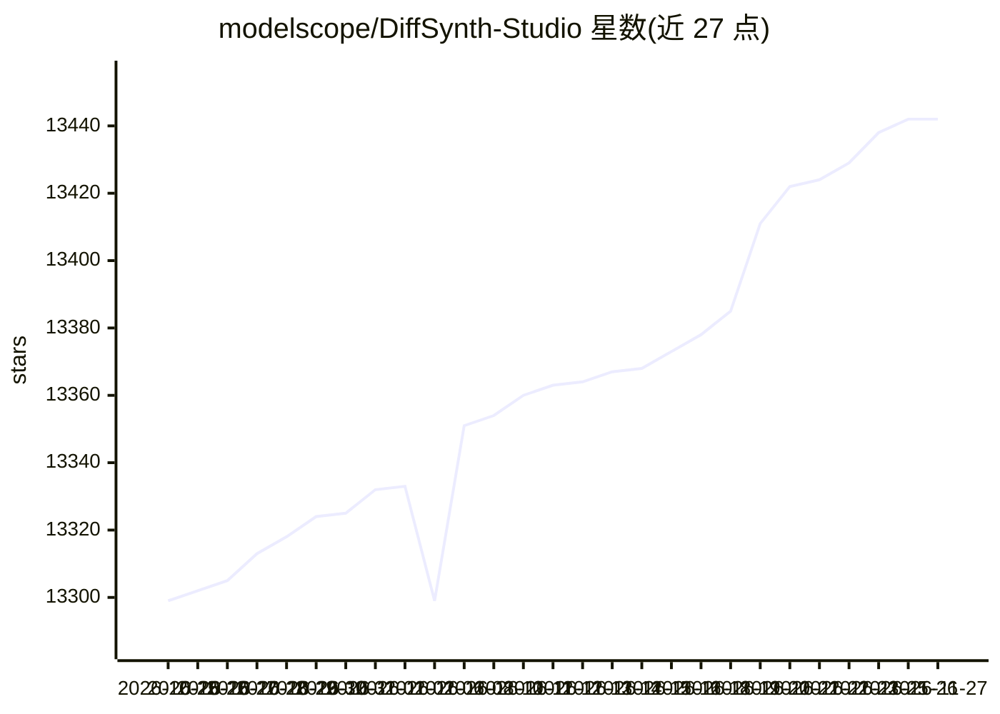

# modelscope/DiffSynth-Studio

⭐ 13,442 · Python · Apache-2.0 · 推送 2026-11-26 · [GitHub](https://github.com/modelscope/DiffSynth-Studio) · 组织维护 · 中文 README

**开源扩散模型引擎：低显存推理与训练图像/视频/音频生成模型**

由 ModelScope 社区团队开发维护的扩散模型框架，集成主流开源 Diffusion 模型，覆盖图像生成、视频生成、音频生成与图像质量评估。核心机制包括跨磁盘/内存/显存的动态参数调度（使低显存消费级 GPU 可运行大模型）、NF4/INT8 等量化、任意模型（基座/LoRA/Adapter）的训练支持，以及基于计算图的两阶段拆分训练。提供开发者文档与 AI 用的 Agent Skills；README 声明开发人力有限，旧版本特性不再维护。

## 筛选速览

| 维度 | 判定 | 备注 |
|---|---|---|
| AI 角色 | `ai-native` | 本体是模型或模型工具 |
| 许可风险 | `permissive` | Apache-2.0 |
| 部署形态 | `library` | 以包/库形式分发 |
| 模型依赖 | — | README 未给出锁定关系 |
| 硬件要求 | `gpu-24g` | |
| 安装摩擦 | `low` | 无编译、无系统依赖或容器化 |
| 成熟度 | — | 结构信号不足 |

## 动量与使用信号

- 维护:`active` — 距上次 push 1.9 天,年发版 1,69 位贡献者
- 涨星:近 1 天 **+3**(自 20261016 起算)
- 平台:WEB · 协议:—

## 能力要点

- 跨磁盘/内存/显存动态参数调度，低显存消费级 GPU 可推理大模型
- NF4/INT8 等量化与 LoRA 训练的显存需求降低
- 支持推理的模型基本都支持训练（基座/LoRA/Adapter）
- 多 GPU 并行推理与 EntroPack 任意码率张量压缩后端

## 适用场景

- 在消费级 GPU 上推理和微调图像/视频生成模型
- 对扩散模型做 LoRA 训练与量化部署
- 通过 ComfyUI 节点包搭建生成工作流

## 场景标签

`图像生成` `视频生成` `微调` `模型量化` · 领域:内容生成

## 证据(README 行号)

> L16: Welcome to the magical world of Diffusion models! DiffSynth-Studio is an open-source Diffusion model engine develop
> L20: * Model Support: The framework integrates mainstream open-source Diffusion models, covering image generation, video
> L21: * VRAM Management: Dynamically schedules model parameters across disk, memory, and VRAM, allowing consumer-grade GP

## 星数曲线

2026-10-25 13,299 → 2026-11-27 13,442（+143）

---
*卡片 v1 · prompt 1.4 · 生成 2026-11-27 · 置信度 high · 依据 README sha `1a1b65dda3a9` · [字段定义](../../DATASET.md)*
