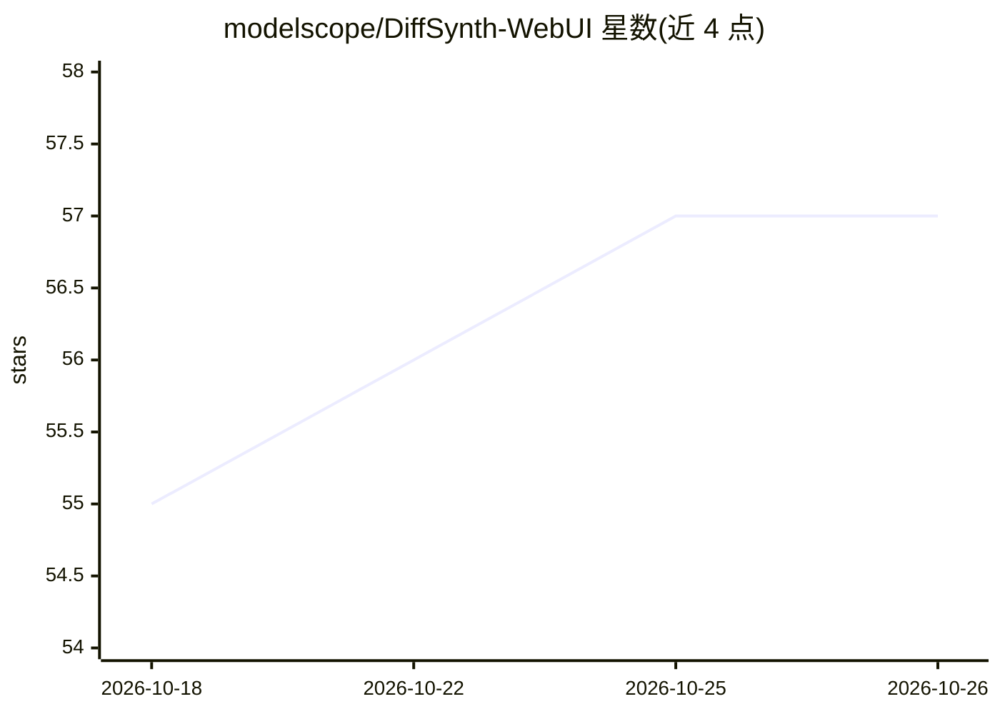

# modelscope/DiffSynth-WebUI

⭐ 57 · TypeScript · Apache-2.0 · 推送 2026-10-19 · [GitHub](https://github.com/modelscope/DiffSynth-WebUI) · 组织维护 · 中文 README

**浏览器中完成扩散模型 LoRA 微调全流程的可视化训练工作台**

基于 DiffSynth-Studio 的可视化训练工作台，通过浏览器完成扩散模型 LoRA 微调全流程：图像/视频/音频数据集管理与 metadata.jsonl 维护、接入任意 OpenAI 兼容多模态模型批量生成标注、按模型架构选择训练配方并配置 LoRA/分辨率/优化器、训练中的实时日志与 loss 曲线监控、训练后自动采样验证与产物下载。支持 FLUX、Qwen-Image、Stable Diffusion、Wan 等数十个模型族。训练在独立进程运行，关闭浏览器不中断。需 Node.js ≥ 20 构建前端，通过启动脚本运行。

## 筛选速览

| 维度 | 判定 | 备注 |
|---|---|---|
| AI 角色 | `ai-ecosystem` | LLM/agent 周边工具 |
| 许可风险 | `permissive` | Apache-2.0 |
| 部署形态 | `library` | 以包/库形式分发 |
| 模型依赖 | — | README 未给出锁定关系 |
| 硬件要求 | — | 无带数字的原话,不猜 |
| 安装摩擦 | `low` | 无编译、无系统依赖或容器化 |
| 成熟度 | — | 结构信号不足 |

## 能力要点

- 数据集管理 + AI 自动打标（OpenAI 兼容多模态模型批量生成标注）
- 可视化配置 LoRA 训练任务，覆盖图像/视频/音频生成模型族
- 实时日志、loss 曲线监控与训练后自动采样
- 每次运行完整保存配置，结果可复现可重跑

## 适用场景

- 不想写训练脚本和 YAML，在浏览器里微调 LoRA
- 为图像/视频生成模型准备数据集并批量自动打标
- 训练中实时查看日志与 loss，结束后直接验证采样效果

## 场景标签

`微调` · 领域:训练与推理

## 证据(README 行号)

> L3: **A Visual Training Workbench for Diffusion Models**
> L17: Run the entire diffusion LoRA fine-tuning workflow from your browser: **no training scripts, no YAML to edit, no co
> L240: Studio provides the model implementations and the training framework, while the WebUI brings the whole training wo

## 星数曲线

2026-10-18 55 → 2026-10-26 57（+2）

---
*卡片 v1 · prompt 1.4 · 生成 2026-10-24 · 置信度 high · 依据 README sha `c770eff5a696` · [字段定义](../../DATASET.md)*
