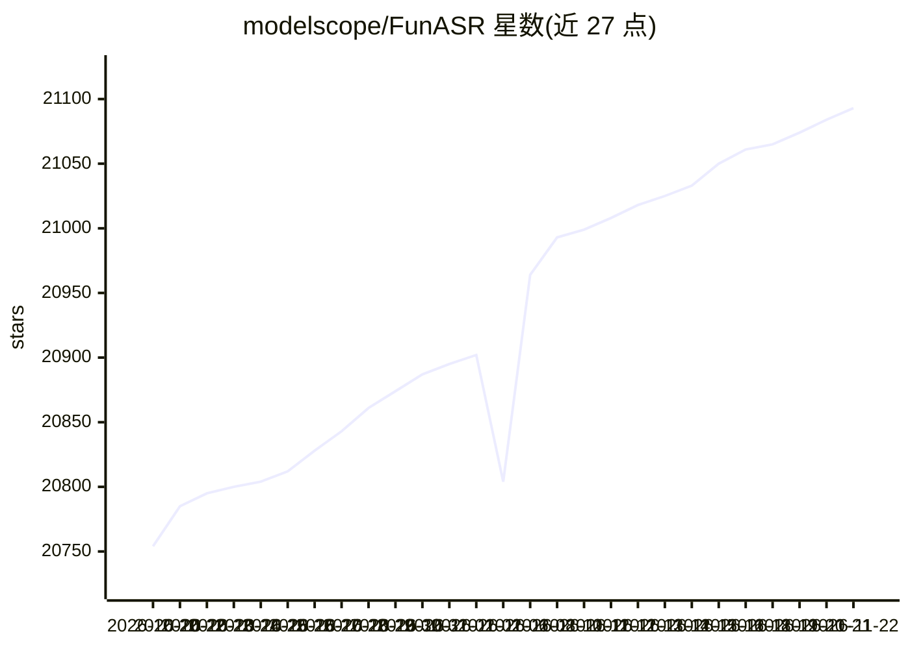

# modelscope/FunASR

⭐ 21,093 · Python · MIT · 推送 2026-11-21 · [GitHub](https://github.com/modelscope/FunASR) · [官网](www.funasr.com) · 组织维护 · 中文 README

**语音识别工具包：训练/推理/流式 ASR 与服务化部署**

FunASR 是一个开源语音识别工具包，覆盖离线转录、流式 ASR、VAD、标点、说话人分离管线及情感/音频事件模型。用户通过 Python AutoModel、CLI（funasr 命令）、HTTP 服务（OpenAI 兼容 /v1/audio/transcriptions）或 GGUF 预编译二进制获得转录结果。工具包与检查点分离：Fun-ASR-Nano 覆盖中英日及方言，Fun-ASR-MLT-Nano 覆盖 31 种语言，SenseVoiceSmall 提供五语言加情感/事件标签。模型许可独立于工具包 MIT 许可，GPU 需自行匹配 PyTorch CUDA 轮子。

## 筛选速览

| 维度 | 判定 | 备注 |
|---|---|---|
| AI 角色 | `ai-native` | 本体是模型或模型工具 |
| 许可风险 | `permissive` | MIT |
| 部署形态 | `self-host` | docker 或自建部署 |
| 模型依赖 | local-ok | 支持本地模型 |
| 硬件要求 | `cpu-ok` | |
| 安装摩擦 | `low` | 无编译、无系统依赖或容器化 |
| 成熟度 | — | 结构信号不足 |

## 动量与使用信号

- 维护:`active` — 距上次 push 1.2 天,年发版 61,202 位贡献者
- 涨星:近 1 天 **+12**(自 20261016 起算)
- 安装:pypi 包 `funasr` 月下载 272,534
- 平台:— · 协议:OPENAI-API / MCP

## 能力要点

- 提供离线、流式、边缘部署三类运行路径（Python/HTTP/GGUF 单文件二进制）
- Model Zoo 含 ASR、VAD、标点、说话人嵌入、情感识别等多类检查点
- OpenAI 兼容 API 服务与 MCP Server、Docker 流式服务镜像
- llama.cpp/GGUF 路径内置 FSMN-VAD，运行时无需 Python

## 适用场景

- 把中文语音批量转录为带标点和时间戳的文本
- 搭建本地 OpenAI 兼容的语音识别 HTTP 服务
- 在无 GPU 的边缘设备上用 GGUF 二进制跑 ASR
- 为语音 agent 接入 MCP 或实时识别插件

## 场景标签

`语音识别` · 领域:感知与多模态

## 证据(README 行号)

> L5:  Industrial speech recognition toolkit for offline, streaming, and edge deployment.
> L112: FunASR is a toolkit: choose the task, checkpoint, and runtime separately.
> L117: |File transcription with emotion/event tags|SenseVoiceSmall|Python `AutoModel`, CPU or GPU|Five-language checkpoin

## 星数曲线

2026-10-20 20,754 → 2026-11-22 21,093（+339）

---
*卡片 v1 · prompt 1.4 · 生成 2026-11-22 · 置信度 high · 依据 README sha `a1fb150b4235` · [字段定义](../../DATASET.md)*
